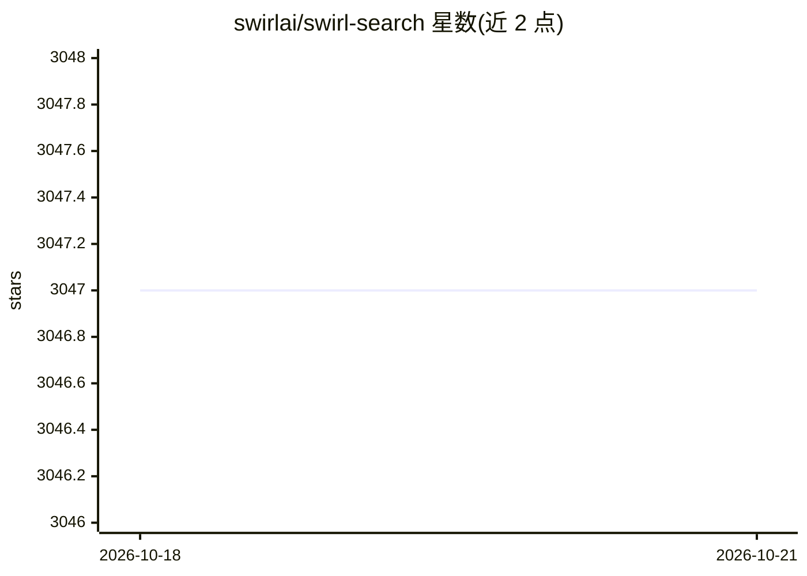

# swirlai/swirl-search

⭐ 3,047 · Python · Apache-2.0 · 推送 2026-10-19 · [GitHub](https://github.com/swirlai/swirl-search) · [官网](https://swirlaiconnect.com/) · 组织维护

**联邦式 AI 搜索与 RAG 引擎：不搬数据直连 100+ 应用问答**

SWIRL Community 是 Apache 2.0 开源的联邦搜索与 RAG 系统：以用户自身权限实时查询 100+ 数据源，就地重排结果（余弦向量相似性，spaCy+NLTK），可选用自己的 OpenAI key 生成带引用的回答，无需向量数据库与 ETL。提供 Galaxy UI、REST API、Pipeline Processor 架构，结果可存 SQLite 或 Postgres。Docker 一条命令部署，约两分钟启动；另存在商业版 SWIRL Enterprise 提供三遍重排、MCP server 等能力。

## 筛选速览

| 维度 | 判定 | 备注 |
|---|---|---|
| AI 角色 | `ai-ecosystem` | LLM/agent 周边工具 |
| 许可风险 | `permissive` | Apache-2.0 |
| 部署形态 | `self-host` | docker 或自建部署 |
| 模型依赖 | — | README 未给出锁定关系 |
| 硬件要求 | — | 无带数字的原话,不猜 |
| 安装摩擦 | `low` | 无编译、无系统依赖或容器化 |
| 成熟度 | — | 结构信号不足 |

## 能力要点

- 联邦搜索 100+ 连接器，数据留在原地不复制
- 实时 RAG 带可点击引用，使用用户自己的 OpenAI key
- 余弦向量相似性重排、去重与结果混合器
- Docker 单命令部署，默认即可搜索 Arxiv/European PMC/Google News

## 适用场景

- 跨 SharePoint、Confluence、Drive 做带来源链接的知识库搜索
- 客服助手检索文档与工单并生成有据回答
- 开发者跨 GitHub、Jira 与文档做统一搜索

## 场景标签

`RAG` `语义搜索` · 领域:知识与检索

## 证据(README 行号)

> L7: Ask a question. SWIRL searches your apps live, ranks the results, and returns an answer with sources you can click t
> L22: Most "AI search" asks you to copy everything into a vector database first, then govern that copy forever. SWIRL ski

## 星数曲线

2026-10-18 3,047 → 2026-10-21 3,047（+0）

---
*卡片 v1 · prompt 1.4 · 生成 2026-10-20 · 置信度 high · 依据 README sha `06e81ba8460d` · [字段定义](../../DATASET.md)*
