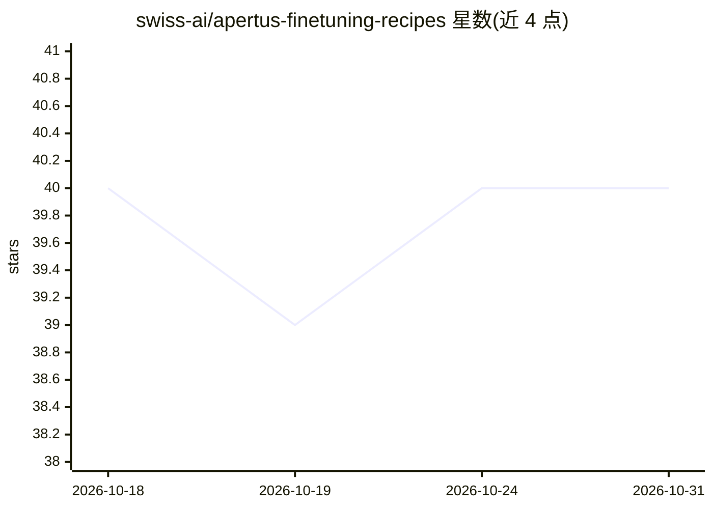

# swiss-ai/apertus-finetuning-recipes

⭐ 40 · Python · Apache-2.0 · 推送 2026-10-12 · [GitHub](https://github.com/swiss-ai/apertus-finetuning-recipes) · [官网](https://apertus-ai.org/docs/tech/fine-tuning/) · 组织维护

**Apertus 系列模型的全参数与 LoRA 微调配方仓库**

由 Swiss AI Initiative 维护的微调脚本与配置集合，面向 Apertus 系列开源模型（1.5/1.1 Mini/1.0）。基于 TRL 框架构建，支持 LoRA 单 GPU 训练、全参数 4 GPU（DeepSpeed zero3）训练及多节点训练；通过 YAML 配置切换模型规模、数据集与超参，训练产物包含 LoRA 适配器权重与完整模型，可用 transformers/peft 加载。限制：1.5 版权重需额外配置才有完整支持；70B 全参数训练需多 GPU 与较长时间。

## 筛选速览

| 维度 | 判定 | 备注 |
|---|---|---|
| AI 角色 | `ai-ecosystem` | LLM/agent 周边工具 |
| 许可风险 | `permissive` | Apache-2.0 |
| 部署形态 | `None` |  |
| 模型依赖 | — | README 未给出锁定关系 |
| 硬件要求 | — | 无带数字的原话,不猜 |
| 安装摩擦 | `low` | 无编译、无系统依赖或容器化 |
| 成熟度 | `idea` | |

## 能力要点

- 覆盖 LoRA、全参数与多节点（3 节点 x 4 GPU）训练路径
- 基于 TRL 框架，配置 YAML 可切换模型与数据集
- 输出 LoRA 适配器或完整模型，可用 transformers/peft 加载
- 兼容 Apertus 全版本模型家族

## 适用场景

- 在自己的数据集上对 Apertus 模型做 SFT 微调
- 用单 GPU 对小模型做 LoRA 训练
- 多节点集群上做 70B 级全参数训练

## 场景标签

`微调` · 领域:训练与推理

## 证据(README 行号)

> L3: This repository provides fine-tuning recipes for the Apertus models from the Swiss AI Initiative, supporting both fu
> L19: Based on the TRL framework (we may add others in the future), these recipes are optimized for efficient training on

## 星数曲线

2026-10-18 40 → 2026-10-31 40（+0）

---
*卡片 v1 · prompt 1.4 · 生成 2026-10-25 · 置信度 high · 依据 README sha `b01006368b8e` · [字段定义](../../DATASET.md)*
