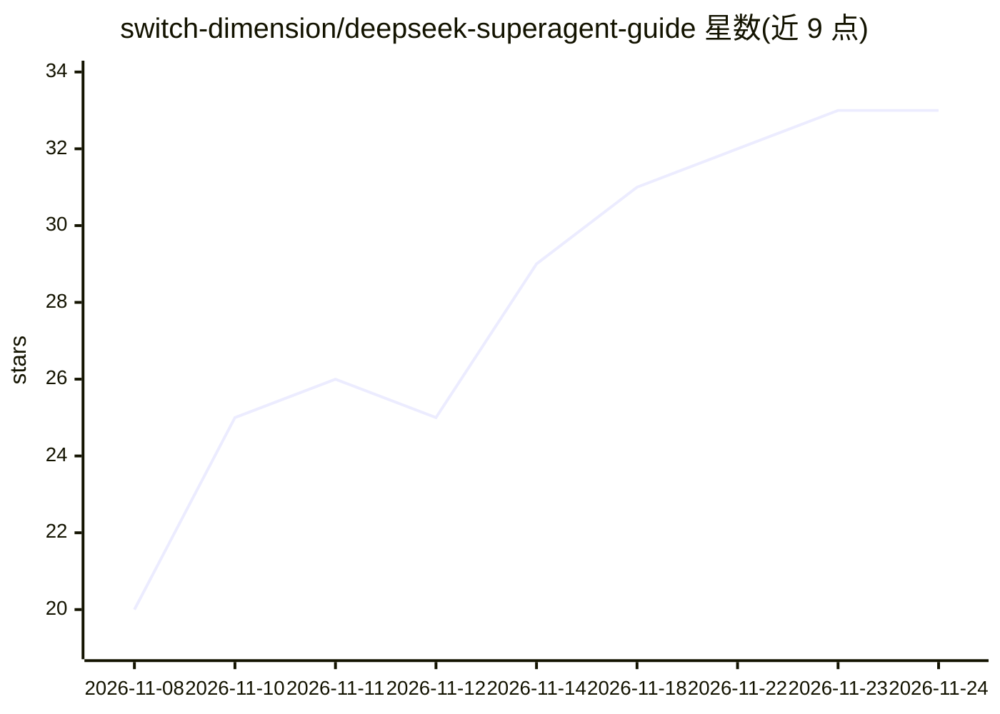

# switch-dimension/deepseek-superagent-guide

⭐ 33 · MIT · 推送 2026-11-03 · [GitHub](https://github.com/switch-dimension/deepseek-superagent-guide) · 个人维护

**教 AI 编程助手搭建 DeepSeek 超级代理模式的指南**

面向 AI 编程助手阅读的教程文档：讲解 DeepSeek 开源的 dsh-superagent-prototype（基于 DeepSeek Harness 的主动式 GitHub 编码代理）的设计，并指导读者用自己的编码代理（Claude Code 或 OpenCode 作为 worker）复刻该模式。文档覆盖授权门控规则、工单生命周期、宿主与 worker 的 sa CLI 契约、确定性反提示注入机制等，CLI 参数在特定版本上验证。本体是纯指南，不含可安装代码；所复刻的实现约 2,800 行 TypeScript，依赖 Node 24、SQLite 与 zod。

## 筛选速览

| 维度 | 判定 | 备注 |
|---|---|---|
| AI 角色 | `ai-knowledge` | 知识聚合/清单类 |
| 许可风险 | `permissive` | MIT |
| 部署形态 | `self-host` | docker 或自建部署 |
| 模型依赖 | — | README 未给出锁定关系 |
| 硬件要求 | — | 无带数字的原话,不猜 |
| 安装摩擦 | `low` | 无编译、无系统依赖或容器化 |
| 成熟度 | — | 结构信号不足 |

## 能力要点

- 讲解 DeepSeek 超级代理的核心设计：授权门控、单工单单会话单 worktree、订阅路由
- 给出 Claude Code 与 OpenCode 两套 worker 适配器的调用方式与 CLI 参数
- 定义宿主与 worker 之间的 sa CLI 契约与环境变量
- 事实与 CLI 参数在指定版本（Claude Code 2.1.316 / OpenCode 2.0.30）上验证

## 适用场景

- 让 Claude Code 或 OpenCode 充当 worker 搭建自己的超级代理
- 学习 DeepSeek 超级代理的授权与反提示注入设计
- 了解主动式 GitHub 编码代理的工单生命周期管理

## 场景标签

`教程课程` · 领域:学习与行业

## 证据(README 行号)

> L3: A guide for an AI coding assistant. Read it fully before acting. It explains what DeepSeek's "superagent" is, and ho
> L33: 2. **Your own version of the pattern, with Claude Code or OpenCode as the worker.** This is the rest of this guide.

## 星数曲线

2026-11-08 20 → 2026-11-24 33（+13）

---
*卡片 v1 · prompt 1.4 · 生成 2026-11-18 · 置信度 mid · 依据 README sha `ca051b5aa8d1` · [字段定义](../../DATASET.md)*
