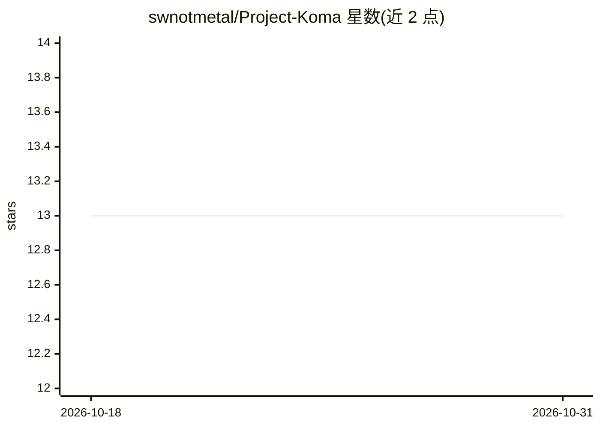

# swnotmetal/Project-Koma

⭐ 13 · TypeScript · MIT · 推送 2026-10-13 · [GitHub](https://github.com/swnotmetal/Project-Koma) · 个人维护 · 中文 README

**面向 Node.js/TS 的 AI 安全工具包：提示注入防护与 agent 技能检查**

由多个可独立使用的包组成的 AI 安全工具集：koma-miko 在 Claude Code/Codex 的 Hook 层拦截文件编辑、核验 agent 是否已加载所需 Skill；koma-gate 提供 LLM 分类器拦截提示注入与越狱，支持 OpenAI/Anthropic/Google/DeepSeek/Ollama 模型；koma-scout 做限流、音频上传校验与地域白名单；koma-core 提供索引与内容分离的受保护 RAG 存储。纯 TypeScript、运行时零依赖（Scout 声明 Express peer），MIT 许可。README 明确声明其不是完整安全边界、不能证明模型理解了指令。

## 筛选速览

| 维度 | 判定 | 备注 |
|---|---|---|
| AI 角色 | `ai-ecosystem` | LLM/agent 周边工具 |
| 许可风险 | `permissive` | MIT |
| 部署形态 | `library` | 以包/库形式分发 |
| 模型依赖 | local-ok | 支持本地模型 |
| 硬件要求 | — | 无带数字的原话,不猜 |
| 安装摩擦 | `low` | 无编译、无系统依赖或容器化 |
| 成熟度 | `idea` | |

## 能力要点

- Miko 在 Hook 层核验 Skill 加载后放行文件编辑，确定性检查、不调用 LLM
- Gate 拦截提示注入，实测 1,769 次攻击，DeepSeek 后端召回 98.8%
- 索引与内容分离的 RAG 存储，HKDK 派生不透明令牌做检索门控
- 运行时零第三方依赖（Scout 的 Express 为 peer 依赖），CodeQL 每次推送扫描

## 适用场景

- 给 Claude Code/Codex 编码 agent 加装 Skill 加载的强制检查
- 在 LLM 应用入口拦截提示注入与越狱请求
- 保护 RAG 知识库免遭枚举与批量抓取

## 场景标签

`网络安全` · 领域:学习与行业

## 证据(README 行号)

> L111: |Boundary|Failure mode|What Koma checks|Package|
> L114: |User → LLM|Prompt injection / jailbreak|Semantic scope before the application model|`koma-gate`|
> L183: **`koma-gate`** — Prompt injection firewall. LLM-based scope classifier that blocks jailbreaks, off-topic requests

## 星数曲线

2026-10-18 13 → 2026-10-31 13（+0）

---
*卡片 v1 · prompt 1.4 · 生成 2026-10-31 · 置信度 high · 依据 README sha `ccfbffccdcec` · [字段定义](../../DATASET.md)*
