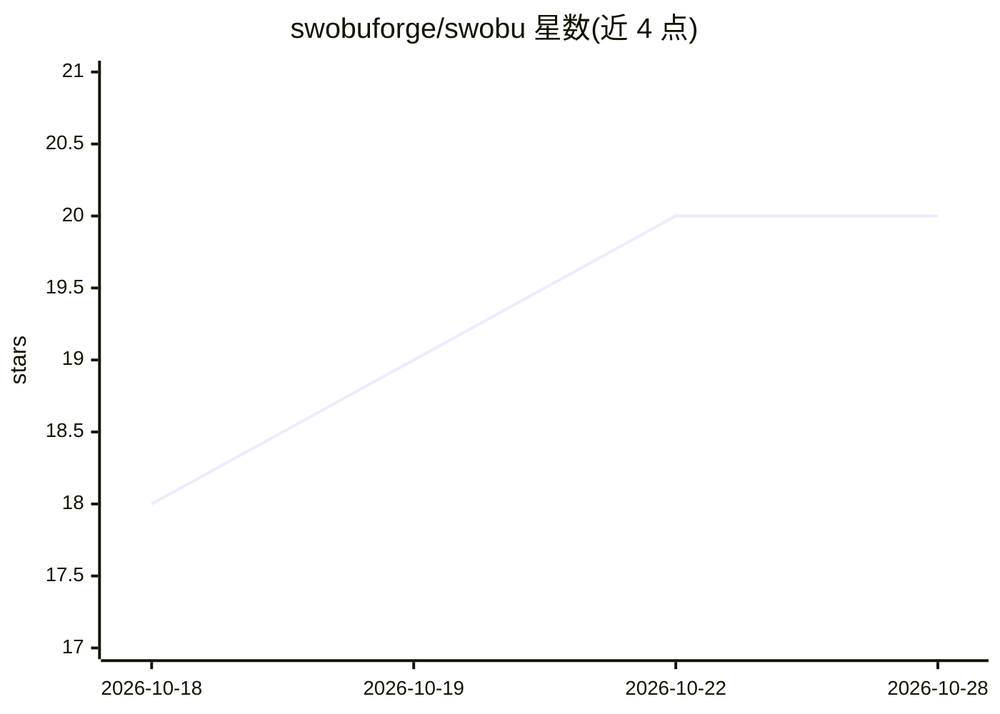

# swobuforge/swobu

⭐ 20 · Go · AGPL-3.0 · 推送 2026-10-25 · [GitHub](https://github.com/swobuforge/swobu) · [官网](https://swobu.com) · 组织维护 · 中文 README

**面向 Claude Code 等 coding agent 的本地 LLM 网关：路由聚合多家算力**

本地运行的 LLM 交换机/网关：将供应商账号、云区域、托管端点与本地 GPU 池化为稳定的路由名，代理客户端保持单一端点，由其处理路由、运行时回退与协议翻译（OpenAI Responses/Chat Completions、Anthropic Messages、Gemini Interactions）。支持 Claude Code、Codex、Antigravity 等客户端接入，OpenAI、Anthropic、Gemini、Bedrock、Azure AI、Mistral、DeepSeek、Ollama 等作为后端容量。本地使用无需账户，供应商密钥留在本机；可生成 HTTPS 共享端点并随时撤销。不检查实时配额、价格、健康或延迟，不做预检式兼容性测试。提供 macOS/Linux/WSL 脚本与 PowerShell 安装，及带 SHA-256 校验的各平台二进制。

## 筛选速览

| 维度 | 判定 | 备注 |
|---|---|---|
| AI 角色 | `ai-ecosystem` | LLM/agent 周边工具 |
| 许可风险 | `viral` | AGPL-3.0 |
| 部署形态 | `None` |  |
| 模型依赖 | local-ok | 支持本地模型 |
| 硬件要求 | — | 无带数字的原话,不猜 |
| 安装摩擦 | `low` | 无编译、无系统依赖或容器化 |
| 成熟度 | — | 结构信号不足 |

## 能力要点

- 路由抽象：一个模型名背后池化供应商账号、区域、端点与本地服务器
- 请求失败后的运行时回退分层，非预检模式
- 四种协议族间的边界翻译（OpenAI Responses/Chat Completions、Anthropic Messages、Gemini）
- swobu share 生成 HTTPS 端点与 bearer，供应商密钥不出本机，TLS 端到端到本机

## 适用场景

- 我有多个供应商账号和云区域额度，想在不改 agent 配置的情况下切换后端
- 把本地 GPU 和云端模型放在同一路由下，失败时自动回退
- 给远程协作者共享一个路由端点而不暴露供应商密钥，事后撤销

## 场景标签

`模型网关` · 领域:Agent 开发

## 证据(README 行号)

> L7: Put provider accounts, cloud regions, hosted endpoints, and local GPUs behind stable model names. Your agents keep o
> L13:  Claude Code, Codex, Antigravity and other clients route through Swobu to provider capacity including OpenAI, Anthr
> L54: Routes can pool provider accounts, regions, hosted endpoints, local servers, and models. Peer target order changes 

## 星数曲线

2026-10-18 18 → 2026-10-28 20（+2）

---
*卡片 v1 · prompt 1.4 · 生成 2026-10-28 · 置信度 high · 依据 README sha `f0ee09f850cd` · [字段定义](../../DATASET.md)*
