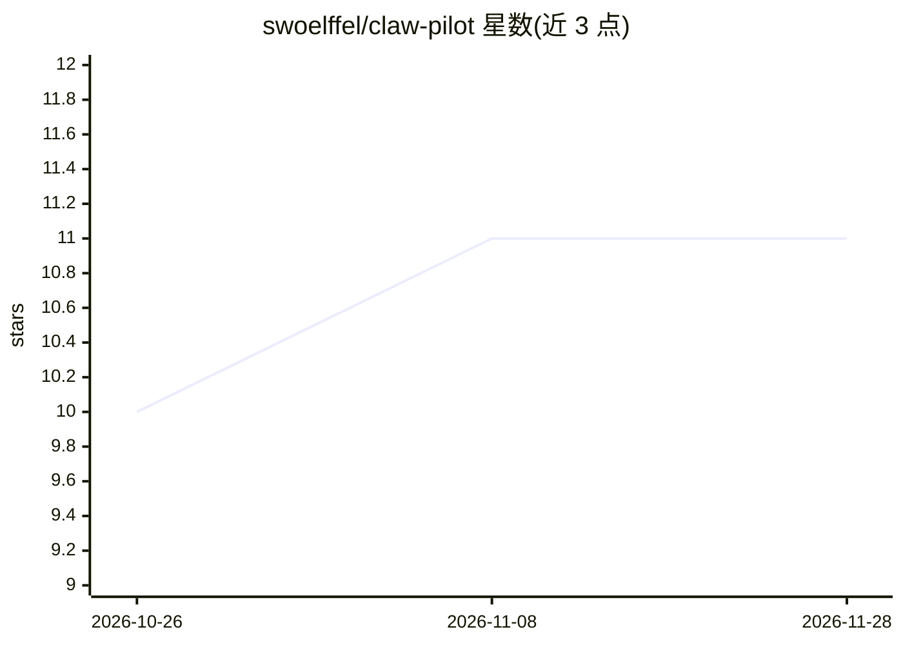

# swoelffel/claw-pilot

⭐ 11 · TypeScript · MIT · 推送 2026-10-16 · [GitHub](https://github.com/swoelffel/claw-pilot) · [官网](https://clawpilot.eu) · 个人维护

**自托管多智能体编排运行时：任务板、流程引擎、预算控制与实时面板**

在自有服务器上运行多个 LLM agent 的编排运行时：通过 A2A 消息互联 agent、心跳调度定时任务、DAG 声明式流程引擎（fan-out/重试/超时）、月度预算硬停与 Telegram 告警，并提供实时 Web 仪表盘（多 agent 聊天、成本追踪、任务看板、记忆浏览）。以 Node.js ≥22.12 与 pnpm 构建，Linux/macOS 自托管，CLI 管理实例生命周期，数据集中于单一 SQLite registry 数据库。面向需要自托管多 agent 团队的开发者。

## 筛选速览

| 维度 | 判定 | 备注 |
|---|---|---|
| AI 角色 | `ai-ecosystem` | LLM/agent 周边工具 |
| 许可风险 | `permissive` | MIT |
| 部署形态 | `library` | 以包/库形式分发 |
| 模型依赖 | — | README 未给出锁定关系 |
| 硬件要求 | — | 无带数字的原话,不猜 |
| 安装摩擦 | `low` | 无编译、无系统依赖或容器化 |
| 成熟度 | — | 结构信号不足 |

## 能力要点

- A2A 消息、心跳调度与 DAG 流程引擎的 agent 编排机制
- 预算控制：软告警 80%、硬停 100%、自动暂停与 Telegram 通知
- MCP 集成：逐实例服务器注册表、stdio + HTTP 传输、实时工具发现
- 实时仪表盘含多 agent 聊天、token/成本追踪与 6 语言 UI

## 适用场景

- 在自有服务器上组建带花费上限的多 agent 运维团队
- 用 cron 触发的 DAG 流程执行每日巡检与报告
- 搭建跨 Web/Telegram/CLI 通道的持久会话助手

## 场景标签

`多智能体` `Agent 框架` · 领域:Agent 开发

## 证据(README 行号)

> L3: > **Self-hosted multi-agent orchestration runtime — task board, flow engine, budget control, real-time dashboard.**
> L11: Run a team of LLM agents on your own server. Wire them together with A2A messaging, schedule them with heartbeats, 

## 星数曲线

2026-10-26 10 → 2026-11-28 11（+1）

---
*卡片 v1 · prompt 1.4 · 生成 2026-11-18 · 置信度 high · 依据 README sha `233f5515ddd2` · [字段定义](../../DATASET.md)*
