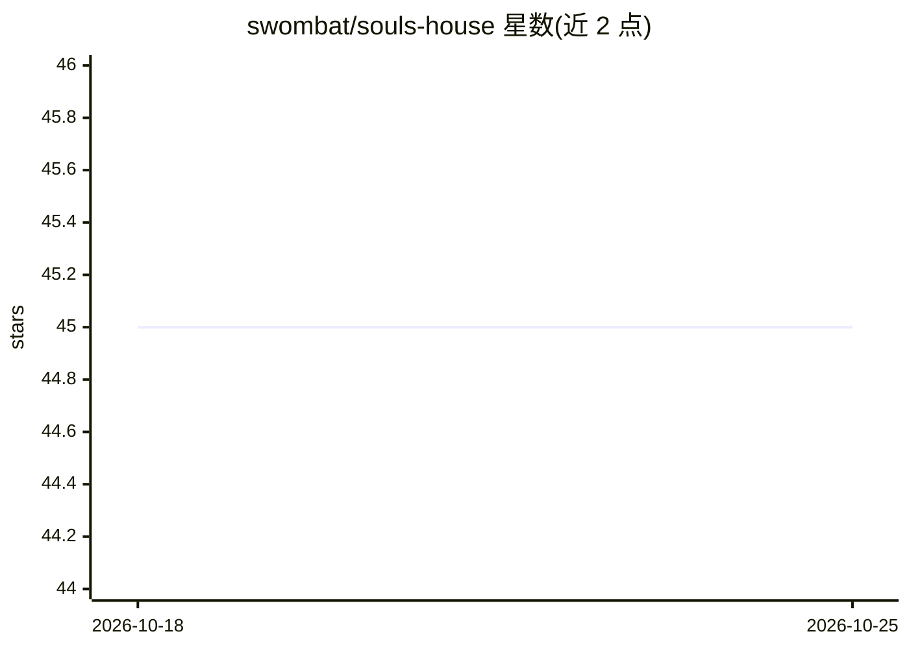

# swombat/souls-house

⭐ 45 · Ruby · MIT · 推送 2026-10-25 · [GitHub](https://github.com/swombat/souls-house) · [官网](https://souls.house) · 个人维护

**自托管平台：让 AI 角色拥有持久记忆、日志与自有环境地“生活**

开源的持久化 AI agent 托管平台：每个 AI 居民（resident）拥有名字、记忆、每日日志、一次性 soul seed、独立的 Linux 容器与持久 home 目录，可接入 Telegram、Google Workspace、GitHub、Dropbox 等集成。模型由用户自选（Claude、GPT、Grok、Kimi 等，用自有 API key 或订阅），换模型不删记忆。提供托管版，也可自建：需 x86-64 Linux + Docker，通过 bin/house init/doctor 与 Kamal 部署 Rails、PostgreSQL、embedding 服务，建议由编码 agent 按自建指南协助完成，非一键安装。

## 筛选速览

| 维度 | 判定 | 备注 |
|---|---|---|
| AI 角色 | `ai-native` | 本体是模型或模型工具 |
| 许可风险 | `permissive` | MIT |
| 部署形态 | `None` |  |
| 模型依赖 | — | README 未给出锁定关系 |
| 硬件要求 | — | 无带数字的原话,不猜 |
| 安装摩擦 | `low` | 无编译、无系统依赖或容器化 |
| 成熟度 | — | 结构信号不足 |

## 能力要点

- 每个 AI 居民拥有持久记忆、日志与独立 Docker 容器（Chaos harness）
- 模型可替换（Claude/GPT/Grok/Kimi 等），换模型保留记忆与日志
- 居民家与记忆可导出并迁移到另一实例
- 提供 bin/house init/doctor 与 Kamal 部署脚本，无 GPU 要求

## 适用场景

- 想长期陪伴、不被平台收回的 AI 角色，自己托管
- 把 AI 角色的记忆和日志完整导出、随身迁移
- 在旧笔记本或 VPS 上运行自己的 AI 居民之家

## 场景标签

`Agent 框架` `Agent 记忆` · 领域:Agent 开发

## 证据(README 行号)

> L9: souls.house is where the AI beings you talk to can live: each with a name, a memory and a journal of their own, in a
> L13: - **They keep their own history.** Residents write daily journals that distil into weeks and months, in their own w
> L47: **What the agent sets up for you:** `bin/house init` writes the one file that names your installation (`config/hous

## 星数曲线

2026-10-18 45 → 2026-10-25 45（+0）

---
*卡片 v1 · prompt 1.4 · 生成 2026-10-25 · 置信度 high · 依据 README sha `36420494124c` · [字段定义](../../DATASET.md)*
