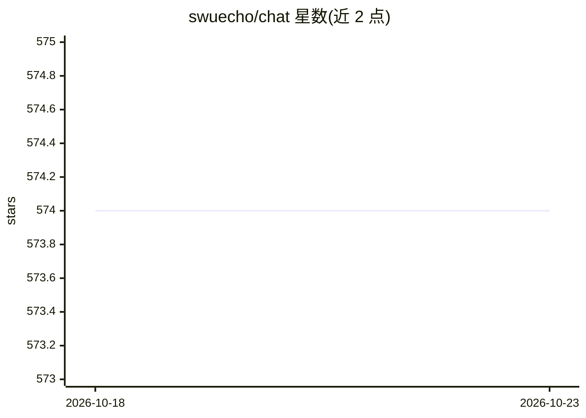

# swuecho/chat

⭐ 574 · Go · MIT · 推送 2026-10-11 · [GitHub](https://github.com/swuecho/chat) · 个人维护 · 中文 README

**面向团队的 ChatGPT 式聊天 Web 应用，含用户管理与限流**

团队用 SaaS 聊天 Web 应用：首个注册用户成为管理员，支持多模型接入（OpenAI/Azure、Claude、Ollama 本地模型），默认限流 100 次/10 分钟。功能包括可分享的对话静态页面（类似 ShareGPT）、对话快照目录与全文搜索、提示词管理（'/' 快捷键）、文本及多媒体文件上传（多媒体需模型支持）。内置 OpenAI 兼容网关，通过可撤销虚拟 API Key 调用已配置模型，支持流式透传、按 key 限流与请求审计；移动端用 Flutter 构建。提供本地开发、部署与添加新模型文档。

## 筛选速览

| 维度 | 判定 | 备注 |
|---|---|---|
| AI 角色 | `ai-native` | 本体是模型或模型工具 |
| 许可风险 | `permissive` | MIT |
| 部署形态 | `None` |  |
| 模型依赖 | local-ok | 支持本地模型 |
| 硬件要求 | — | 无带数字的原话,不猜 |
| 安装摩擦 | `low` | 无编译、无系统依赖或容器化 |
| 成熟度 | — | 结构信号不足 |

## 能力要点

- 支持 OpenAI/Azure、Claude 与 Ollama 本地模型
- 内置 OpenAI 兼容网关（虚拟 API Key、流式透传、限流、请求审计）
- 对话快照目录支持英文全文搜索，可生成可分享静态页面
- 提示词管理与 '/' 快捷键，首个注册用户为管理员

## 适用场景

- 团队共用一个多模型聊天界面并按用户限流
- 通过 OpenAI 兼容网关用统一 Key 调用多种已配置模型
- 整理、搜索并分享团队对话记录
- 搭配本地 Ollama 模型进行内部聊天

## 场景标签

 · 领域:团队协作/AI 聊天应用

## 证据(README 行号)

> L28: - 默认限流 100 chatGPT call /10分钟 (OPENAI_RATELIMIT=100)
> L31: - 支持OPEN AI, Claude 模型
> L36: - 内置 OpenAI 兼容网关，可通过虚拟 API Key 调用已配置的模型

## 星数曲线

2026-10-18 574 → 2026-10-23 574（+0）

---
*卡片 v1 · prompt 1.4 · 生成 2026-10-21 · 置信度 high · 依据 README sha `668321a35966` · [字段定义](../../DATASET.md)*
