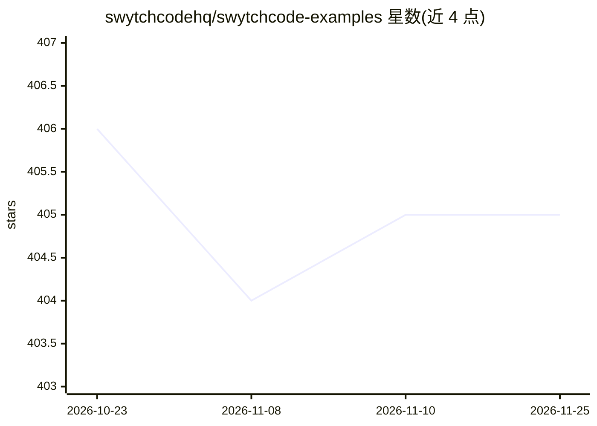

# swytchcodehq/swytchcode-examples

⭐ 405 · TypeScript · MIT · 推送 2026-10-27 · [GitHub](https://github.com/swytchcodehq/swytchcode-examples) · [官网](https://swytchcode.com) · 组织维护

**为开发者提供 AI agent 工作流的官方示例与脚手架模板集**

Swytchcode 官方示例仓库，收录可直接脚手架生成的入门模板与供克隆研究的参考架构，覆盖客户入驻、支付、工单分诊、线索路由、周报分发、合规流程、退款处理等十余个 agent 项目，分别基于 LangGraph、OpenClaw、Swytchcode SDK、CrewAI 等框架实现。通过 npm 全局安装 Swytchcode CLI 后运行交互式生成器选择用例与框架创建项目，各示例需按其自身 README 配置运行。MIT 许可。

## 筛选速览

| 维度 | 判定 | 备注 |
|---|---|---|
| AI 角色 | `ai-knowledge` | 知识聚合/清单类 |
| 许可风险 | `permissive` | MIT |
| 部署形态 | `library` | 以包/库形式分发 |
| 模型依赖 | — | README 未给出锁定关系 |
| 硬件要求 | — | 无带数字的原话,不猜 |
| 安装摩擦 | `low` | 无编译、无系统依赖或容器化 |
| 成熟度 | — | 结构信号不足 |

## 能力要点

- CLI 交互式脚手架生成 6 类用例模板
- 13 个示例项目，覆盖 LangGraph/OpenClaw/Swytchcode SDK/CrewAI/Instinct 等框架
- 参考架构类示例可直接克隆研究
- 声明内置幂等、审计轨迹与策略执行能力（via Swytchcode 平台）

## 适用场景

- 用脚手架快速创建客户入驻、支付、工单分诊等 agent 项目
- 参考多 API 编排的合规与多用户工作流架构
- 了解 LangGraph/OpenClaw 等框架的实际集成写法

## 场景标签

`代码生成` · 领域:编码与开发

## 证据(README 行号)

> L9: This centralized repository houses our official starter templates, reference architectures, and multi-API orchestrat
> L13: The fastest way to scaffold a production-ready agent is via the **Swytchcode CLI**. The CLI provides instant access

## 星数曲线

2026-10-23 406 → 2026-11-25 405（-1）

---
*卡片 v1 · prompt 1.4 · 生成 2026-11-25 · 置信度 high · 依据 README sha `e40cbf5ed53f` · [字段定义](../../DATASET.md)*
