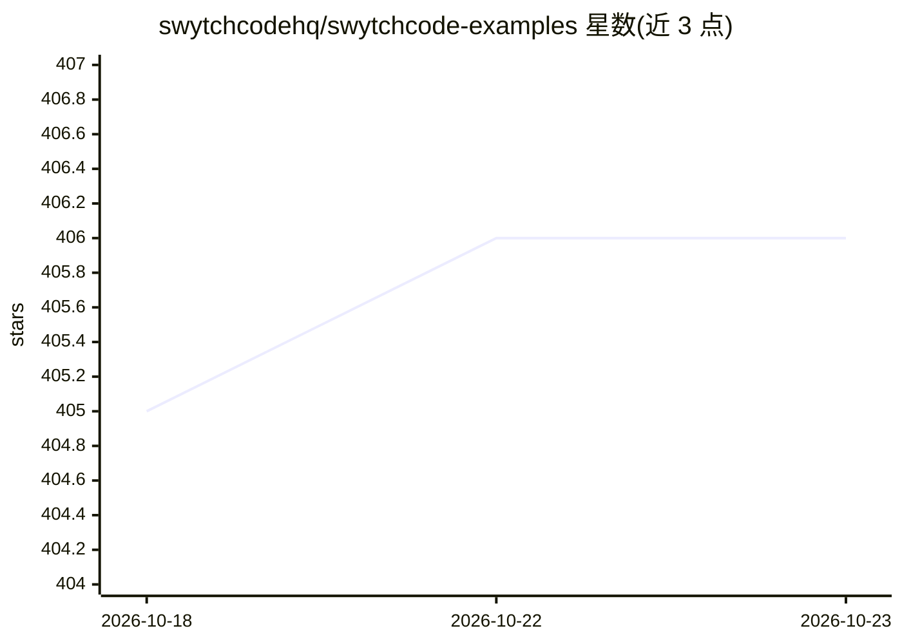

# swytchcodehq/swytchcode-examples

⭐ 406 · TypeScript · MIT · 推送 2026-10-05 · [GitHub](https://github.com/swytchcodehq/swytchcode-examples) · [官网](https://swytchcode.com) · 组织维护

**Swytchcode 官方示例集：AI agent 接入真实 API 的模板与参考架构**

Swytchcode 的官方示例仓库，展示其统一接口与 SDK 如何将自主 AI agent 接入 HubSpot、Stripe、GitHub、Jira、Slack 等真实 API 与工具。提供 13 个示例工程：前 6 个（客户入驻、支付链接、缺陷升级等）可经 swytchcode CLI 交互式脚手架生成，其余为可直接克隆的参考架构，框架覆盖 LangGraph、OpenClaw、OpenAI Agents SDK、CrewAI 与 Swytchcode SDK。面向构建生产级 agent 工作流的开发者，含幂等、审计与策略执行机制说明。

## 筛选速览

| 维度 | 判定 | 备注 |
|---|---|---|
| AI 角色 | `ai-ecosystem` | LLM/agent 周边工具 |
| 许可风险 | `permissive` | MIT |
| 部署形态 | `library` | 以包/库形式分发 |
| 模型依赖 | — | README 未给出锁定关系 |
| 硬件要求 | — | 无带数字的原话,不猜 |
| 安装摩擦 | `low` | 无编译、无系统依赖或容器化 |
| 成熟度 | — | 结构信号不足 |

## 能力要点

- 13 个示例工程覆盖 CRM、支付、工程协作、合规等场景
- swytchcode CLI 交互式脚手架生成项目模板
- 集成 LangGraph、OpenAI Agents SDK、Vercel AI SDK、CrewAI 等框架

## 适用场景

- 基于模板快速搭建接入 Stripe/HubSpot/GitHub 的 agent 工作流
- 学习多 agent 编排与合规守卫的参考架构
- 通过 CLI 脚手架初始化生产级 agent 项目

## 场景标签

`Agent 框架` `多智能体` · 领域:Agent 开发

## 证据(README 行号)

> L7: **Swytchcode** is the standard for connecting autonomous AI agents to real-world APIs, databases, and tooling. By pr
> L9: This centralized repository houses our official starter templates, reference architectures, and multi-API orchestrat

## 星数曲线

2026-10-18 405 → 2026-10-23 406（+1）

---
*卡片 v1 · prompt 1.4 · 生成 2026-10-21 · 置信度 high · 依据 README sha `7ab702eba1dd` · [字段定义](../../DATASET.md)*
