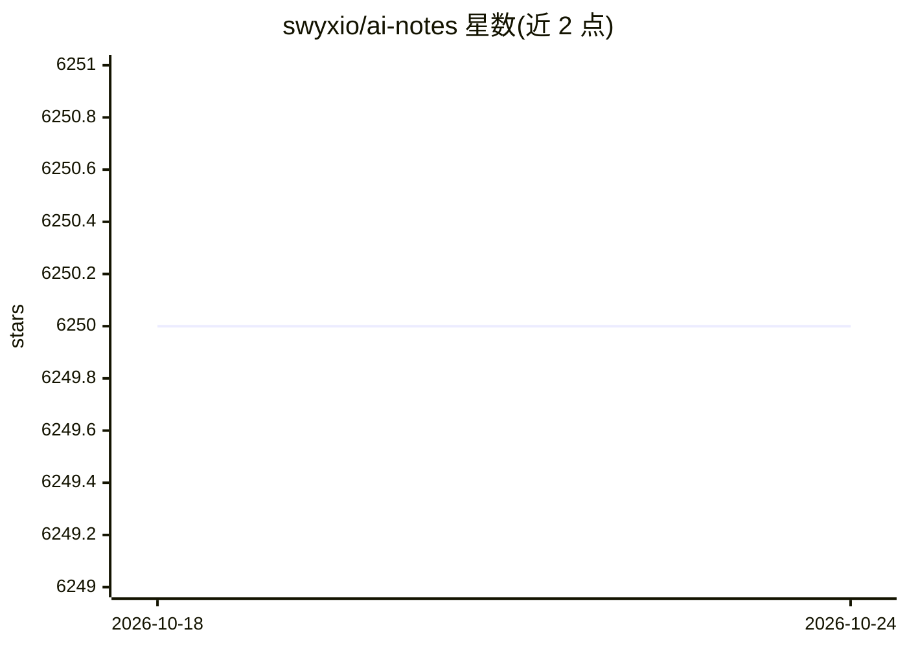

# swyxio/ai-notes

⭐ 6,250 · HTML · MIT · 推送 2026-02-16 · [GitHub](https://github.com/swyxio/ai-notes) · [官网](https://latent.space/) · 个人维护

**软件工程师跟进 AI 进展的笔记与资源知识库**

swyxio 维护的 AI 学习笔记仓库，聚焦生成式 AI 与大语言模型，作为 Latent Space 写作的数据存储。内容按主题拆分为多个 markdown 文件（TEXT/INFRA/AUDIO/CODE/IMAGE_GEN/AGENTS 等），并整理了入门/进阶阅读清单、动机性用例（图像、视频、文生3D、游戏资产）、市场格局图谱与提示词样例。前身为 prompt-eng 仓库，因更名而转向 AI Engineering 笔记定位。提供 Resources 目录下可长期引用的整理版资源。

## 筛选速览

| 维度 | 判定 | 备注 |
|---|---|---|
| AI 角色 | `ai-knowledge` | 知识聚合/清单类 |
| 许可风险 | `permissive` | MIT |
| 部署形态 | `None` |  |
| 模型依赖 | — | README 未给出锁定关系 |
| 硬件要求 | — | 无带数字的原话,不猜 |
| 安装摩擦 | `low` | 无编译、无系统依赖或容器化 |
| 成熟度 | — | 结构信号不足 |

## 能力要点

- 按主题分文件组织：文本生成、基础设施、音频、代码生成、图像生成、Agent 追踪等
- 分级的入门/进阶 AI 阅读清单（Karpathy、Wolfram、a16z AI Canon 等）
- 图像/视频/文生3D/游戏资产等生成式 AI 用例与产品链接汇编
- 风险投资机构市场图谱与 LLM 应用架构资料收录

## 适用场景

- 工程师系统性地补课大语言模型与生成式 AI 基础知识
- 查找提示工程与 Stable Diffusion/GPT 的学习材料与样例
- 浏览生成式 AI 的应用用例和市场格局以做选型调研

## 场景标签

`精选清单` `教程课程` · 领域:学习与行业

## 证据(README 行号)

> L3: notes on AI state of the art, with a focus on generative and large language models. These are the "raw materials" fo
> L7: This Readme is just the high level overview of the space; you should see the most updates in the OTHER markdown file

## 星数曲线

2026-10-18 6,250 → 2026-10-24 6,250（+0）

---
*卡片 v1 · prompt 1.4 · 生成 2026-10-20 · 置信度 high · 依据 README sha `3d97d1f20c0e` · [字段定义](../../DATASET.md)*
