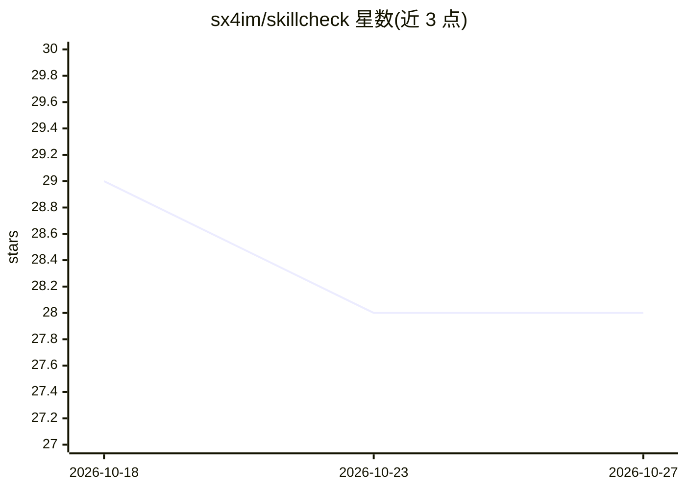

# sx4im/skillcheck

⭐ 28 · TypeScript · MIT · 推送 2026-10-20 · [GitHub](https://github.com/sx4im/skillcheck) · [官网](https://skillcheck.page) · 个人维护

**AI agent 技能与提示词的盲测 A/B 评测工具**

面向开发者的 CLI 评测工具：对 SKILL.md、.cursorrules、CLAUDE.md、系统提示词等 Markdown 指令文件做对照 A/B 实验——任务生成器只看声明领域不看技能正文，同一任务在注入/不注入技能两臂下各跑 K 次，盲评打分后用 1000 次配对 bootstrap 给出效应量、95% 置信区间与 HELPS/PLACEBO/HARMS 判定，并测量 token 开销。以 npm 包分发，支持自带 API key（OpenAI/Anthropic/Gemini/Groq/Mistral/OpenRouter/NVIDIA NIM）或托管云模式（含 10 次免费），可输出 JSON 并集成 CI。

## 筛选速览

| 维度 | 判定 | 备注 |
|---|---|---|
| AI 角色 | `ai-ecosystem` | LLM/agent 周边工具 |
| 许可风险 | `permissive` | MIT |
| 部署形态 | `library` | 以包/库形式分发 |
| 模型依赖 | locked-api |  |
| 硬件要求 | — | 无带数字的原话,不猜 |
| 安装摩擦 | `low` | 无编译、无系统依赖或容器化 |
| 成熟度 | — | 结构信号不足 |

## 能力要点

- 对照双臂 + 盲评 + 1000 次 bootstrap 的统计判定（HELPS/PLACEBO/HARMS）
- 任务生成器不接触技能正文，避免指令泄漏到任务生成
- 支持 SKILL.md/.cursorrules/CLAUDE.md/copilot-instructions 等多种格式
- --json/--output 无头模式与 GitHub Actions 集成

## 适用场景

- 发布 agent 技能前验证它是否真的提升模型表现
- CI 中对提示词改动做回归质量门禁
- 在技能仓库展示经统计验证的效果徽章

## 场景标签

`提示工程` `模型评测` · 领域:Agent 开发

## 证据(README 行号)

> L18: Point it at any Markdown skill or rule file and it runs an automated A/B experiment: it generates fresh domain-spec
> L120: - **CI-friendly LLM eval** — `--json` / `--output` for scripts and pipelines; hosted

## 星数曲线

2026-10-18 29 → 2026-10-27 28（-1）

---
*卡片 v1 · prompt 1.4 · 生成 2026-10-26 · 置信度 high · 依据 README sha `bbfbc8d9af50` · [字段定义](../../DATASET.md)*
