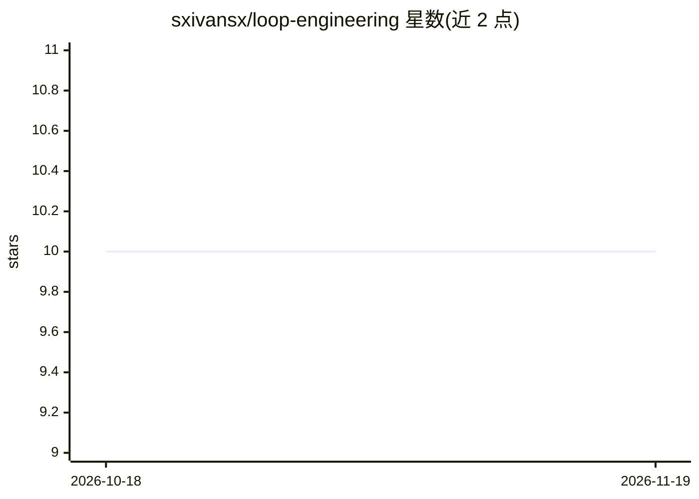

# sxivansx/loop-engineering

⭐ 10 · Shell · MIT · 推送 2026-07-03 · [GitHub](https://github.com/sxivansx/loop-engineering) · 个人维护

**为项目一键搭建自主循环运行的 AI 编码 agent 的 Claude Code 技能**

一个可安装的 Claude Code 技能：在现有仓库中运行 /loop-engineering 后，读取项目已有的测试、构建与工作跟踪方式，生成状态文件 LOOP.md、maker 子代理、独立 checker 子代理、monitor 监督代理与触发器（命令、定时任务、hook、GitHub Action），循环执行“发现工作→实现→验证→记录”直至满足可验证的停止条件（stop-check.sh 退出 0）。内置护栏：checker 与 maker 分离、不可逆操作需人工确认、三次失败转 Blocked、迭代上限与沙箱隔离。MIT 许可，git clone 安装。

## 筛选速览

| 维度 | 判定 | 备注 |
|---|---|---|
| AI 角色 | `ai-ecosystem` | LLM/agent 周边工具 |
| 许可风险 | `permissive` | MIT |
| 部署形态 | `None` |  |
| 模型依赖 | — | README 未给出锁定关系 |
| 硬件要求 | — | 无带数字的原话,不猜 |
| 安装摩擦 | `low` | 无编译、无系统依赖或容器化 |
| 成熟度 | — | 结构信号不足 |

## 能力要点

- 六原语循环框架：Trigger/State/Discovery/Maker/Checker/Stop condition
- maker 与 checker 分离，checker 独立验证且可自动拒绝篡改测试的 diff
- monitor 代理在漂移、空转或越界时暂停循环并上报人工
- 支持无人值守运行（loop.sh 迭代上限、GitHub Action 定时模板）

## 适用场景

- 让 agent 持续保持主分支 CI 绿色
- 在 issue 队列上循环处理代码改进项
- 按设定节奏自动运行代码审查与安全审计并把发现转为工作项

## 场景标签

`编码 Agent` `代码审查` · 领域:编码与开发

## 证据(README 行号)

> L11: This repo is an installable Claude Code skill. Run `/loop-engineering` inside any existing repo and it scaffolds th
> L98: **What does it work with?** This skill targets Claude Code (`/goal`, `/loop`, scheduled tasks, subagents, hooks, MC

## 星数曲线

2026-10-18 10 → 2026-11-19 10（+0）

---
*卡片 v1 · prompt 1.4 · 生成 2026-11-19 · 置信度 high · 依据 README sha `aca6f43b69e9` · [字段定义](../../DATASET.md)*
