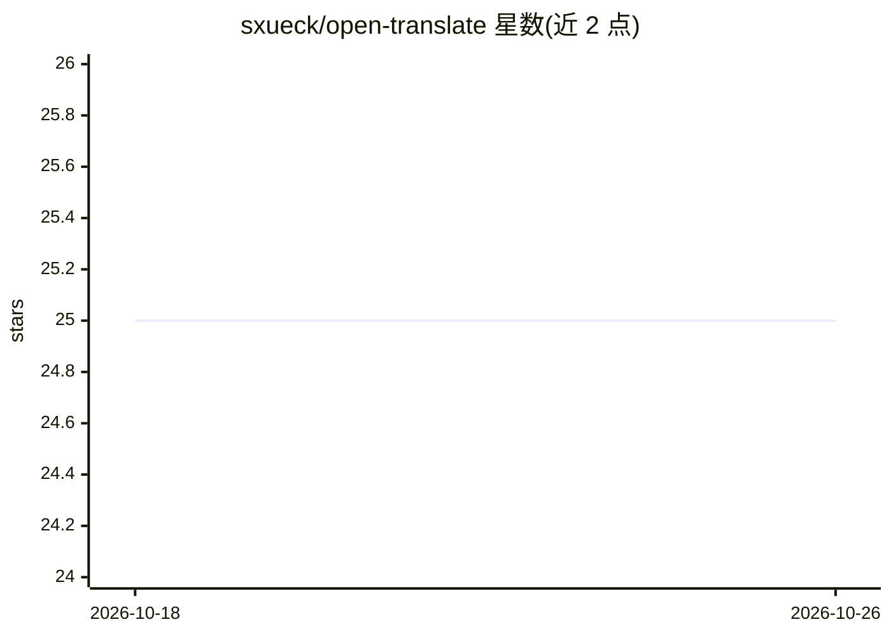

# sxueck/open-translate

⭐ 25 · JavaScript · 推送 2026-04-10 · [GitHub](https://github.com/sxueck/open-translate) · 个人维护 · 中文 README

**调用 OpenAI 兼容 API 做网页翻译的 Chrome 扩展**

Chrome 浏览器扩展：通过用户配置的 OpenAI 兼容 API 端点（GPT、Claude、Gemini 等）对整页网页进行 LLM 翻译，支持替换与双语两种显示模式，保留原页面 HTML 结构与 CSS 样式，并提供右键菜单、输入框快捷键翻译（实验性）与模型列表拉取管理。面向需要用自选 LLM 服务阅读外语网页的用户。Chrome 商店尚在审核，需从 Release 下载或以开发者模式加载源码安装，需自行提供 API key。

## 筛选速览

| 维度 | 判定 | 备注 |
|---|---|---|
| AI 角色 | `ai-native` | 本体是模型或模型工具 |
| 许可风险 | `none` | — |
| 部署形态 | `None` |  |
| 模型依赖 | — | README 未给出锁定关系 |
| 硬件要求 | — | 无带数字的原话,不猜 |
| 安装摩擦 | `low` | 无编译、无系统依赖或容器化 |
| 成熟度 | `idea` | |

## 能力要点

- 连接任意 OpenAI 兼容 API 端点并拉取可用模型列表
- 替换/双语两种翻译模式，保留原页面布局
- 右键菜单翻译页面或选中文本，F2 输入框翻译（实验性）

## 适用场景

- 用自选的 LLM 服务翻译整页外语网页
- 以双语对照方式阅读原文与译文
- 在输入框中快捷翻译要发送的外语文本

## 场景标签

 · 领域:浏览器工具/翻译

## 证据(README 行号)

> L22: - **OpenAI API Compatible**: Works with any OpenAI-compatible translation service (LLM translation services only)
> L122: This extension works with any OpenAI-compatible API service:

## 星数曲线

2026-10-18 25 → 2026-10-26 25（+0）

---
*卡片 v1 · prompt 1.4 · 生成 2026-10-26 · 置信度 high · 依据 README sha `85cb00cbfa90` · [字段定义](../../DATASET.md)*
