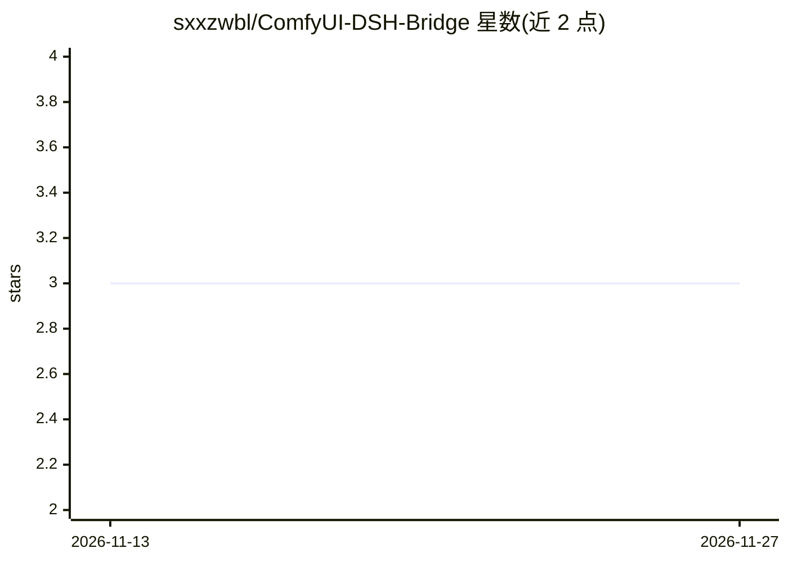

# sxxzwbl/ComfyUI-DSH-Bridge

⭐ 3 · Python · MIT · 推送 2026-11-07 · [GitHub](https://github.com/sxxzwbl/ComfyUI-DSH-Bridge) · 个人维护 · 中文 README

**把 DeepSeek 接入 ComfyUI 的提示词生成节点**

ComfyUI 自定义节点插件，将 DeepSeek Harness 作为推理后端：视频均匀抽帧拼成带时间轴的帧阵列图，连同参考图送入模型，按任务自动调用随插件安装的 markdown skill，输出 MiniMax H3 提示词；提供会话面板支持在同一会话中追问与逐版修改。要求本机安装并登录 DeepSeek Harness，另需到开放平台申请 API key，通过 install.bat 安装；依赖命名管道与 harness 进程通信，可选安装 dsh-purge 插件提供清洗/回滚按钮。

## 筛选速览

| 维度 | 判定 | 备注 |
|---|---|---|
| AI 角色 | `ai-native` | 本体是模型或模型工具 |
| 许可风险 | `permissive` | MIT |
| 部署形态 | `None` |  |
| 模型依赖 | locked-api |  |
| 硬件要求 | — | 无带数字的原话,不猜 |
| 安装摩擦 | `low` | 无编译、无系统依赖或容器化 |
| 成熟度 | — | 结构信号不足 |

## 能力要点

- 视频均匀抽帧拼成带时间轴的帧阵列图输入
- 模型按任务自动选择随插件安装的 markdown skill
- 会话面板支持追问与基于上一版继续修改
- 通过命名管道复用 harness 运行时，节点与面板共享同一实例

## 适用场景

- 根据视频生成可复刻同款动作与运镜的 MiniMax H3 提示词
- 把视频中人物替换为参考图身份与服装
- 在视频间迁移动作或风格并保留其余要素

## 场景标签

`视频生成` · 领域:内容生成

## 证据(README 行号)

> L3: 把 **DeepSeek Harness（DSH）** 接成 ComfyUI 的提示词推理后端：视频和参考图进去，MiniMax H3 提示词出来。
> L8: - **素材 + 需求 → 结构化提示词**：模型按任务自己调用对应的 skill

## 星数曲线

2026-11-13 3 → 2026-11-27 3（+0）

---
*卡片 v1 · prompt 1.4 · 生成 2026-11-26 · 置信度 high · 依据 README sha `12608a50bf1f` · [字段定义](../../DATASET.md)*
