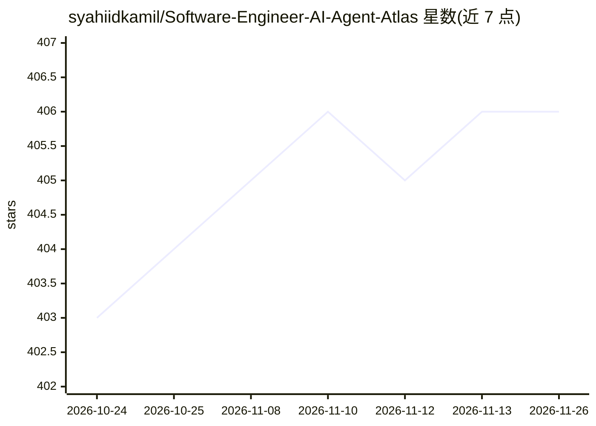

# syahiidkamil/Software-Engineer-AI-Agent-Atlas

⭐ 406 · JavaScript · 推送 2026-11-21 · [GitHub](https://github.com/syahiidkamil/Software-Engineer-AI-Agent-Atlas) · [官网](https://www.npmjs.com/package/swe-atlas) · 个人维护

**把 Claude Code 配置为资深软件工程师 agent 的模板与工作区工具**

SWE-ATLAS 是一个开源 Claude Code 模板与配置工具：通过 skills、subagents、slash commands、hooks 与 CLAUDE.md 规范，为 Claude Code 补充多项目工作区记忆、先线框/原型的规划流程、API 密钥不进入对话、psql 访问 Postgres、浏览器 QA 执行与部署 runbook 等约定。提供三种 CLAUDE.md 风格（Vanilla/Collaborative/Autonomous）与三种工作区模式，通过 npx 一条命令初始化。依赖 Claude Code 自身的 plan mode、/goal 等原生能力执行，ATLAS 负责补充其缺失部分。

## 筛选速览

| 维度 | 判定 | 备注 |
|---|---|---|
| AI 角色 | `ai-ecosystem` | LLM/agent 周边工具 |
| 许可风险 | `none` | — |
| 部署形态 | `self-host` | docker 或自建部署 |
| 模型依赖 | — | README 未给出锁定关系 |
| 硬件要求 | — | 无带数字的原话,不猜 |
| 安装摩擦 | `low` | 无编译、无系统依赖或容器化 |
| 成熟度 | — | 结构信号不足 |

## 能力要点

- 三种 CLAUDE.md 风格与三种工作区模式（单仓库/多仓库/多项目）
- 按项目的小型记忆层（CLAUDE.md/STATUS.md/knowledge notes）跨会话保留状态
- wireframe/prototype 先行的规划流程与可执行的 QA 测试用例
- free-will 技能在高风险决策点生成备选方案并记录决策日志

## 适用场景

- 用 Claude Code 管理多个项目并跨会话保留项目记忆
- 在写代码前先用线框和可点击原型对齐需求
- 让 AI agent 以验收检查而非复述代码的方式生成测试

## 场景标签

`编码 Agent` · 领域:编码与开发

## 证据(README 行号)

> L7: SWE-ATLAS turns Claude Code into a senior AI software engineer agent with skills, subagents, project memory, and eng
> L18: SWE-ATLAS is an open-source **Claude Code template** and **AI coding agent** setup: skills, subagents, slash comman

## 星数曲线

2026-10-24 403 → 2026-11-26 406（+3）

---
*卡片 v1 · prompt 1.4 · 生成 2026-11-25 · 置信度 mid · 依据 README sha `a37a35fe7e48` · [字段定义](../../DATASET.md)*
