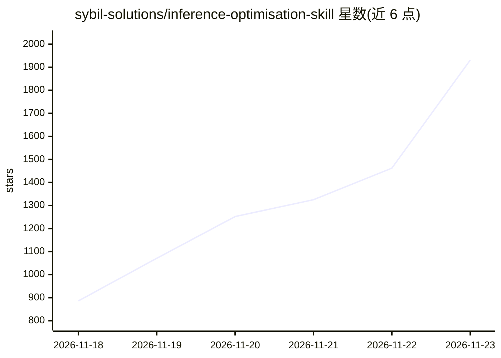

# sybil-solutions/inference-optimisation-skill

⭐ 1,931 · Python · MIT · 推送 2026-11-16 · [GitHub](https://github.com/sybil-solutions/inference-optimisation-skill) · 组织维护

**供 Agent 使用的本地 LLM 推理提速调优技能包**

以 SKILL.md 形式发布的推理性能调优流程技能，覆盖解码、投机解码、prefill、KV cache、启动时间与 TTFT 的逐项爬坡优化。工作流为先算理论上限、单变量改动、交错对照测量、记录失败、长上下文检索门控、固定构建发布。附带标准库 Python 与 bash 写成的引擎无关测量脚本（bench.py/ceiling.py/queue.sh），可无 Agent 直接运行。README 给出 Intel Arc、RTX 3090、H200 上的调优数据及来源链接。

## 筛选速览

| 维度 | 判定 | 备注 |
|---|---|---|
| AI 角色 | `ai-ecosystem` | LLM/agent 周边工具 |
| 许可风险 | `permissive` | MIT |
| 部署形态 | `None` |  |
| 模型依赖 | — | README 未给出锁定关系 |
| 硬件要求 | — | 无带数字的原话,不猜 |
| 安装摩擦 | `medium` | 含编译或系统依赖之一 |
| 成熟度 | — | 结构信号不足 |

## 能力要点

- 六步 hill-climbing 调优流程：理论上限→单变量→交错对照→失败记录→稳定性门控
- bench.py 可测任意 OpenAI 兼容服务器的 TTFT、c1/cN 解码、多长度 prefill、needle 检索与峰值内存
- ceiling.py 从带宽/FLOPs 数据计算解码、prefill、TTFT、KV 上限
- 支持 Claude Code 与任何加载 SKILL.md 的 Agent，PROMPT.md 可直接作任务提示

## 适用场景

- 为本地部署的 LLM 服务器系统化提升解码与 prefill 速度
- 在显存/内存上限内寻找可行的量化与引擎配置
- 评估给定硬件上某模型的吞吐理论上限
- 以交错对照方式做可复现的推理基准测试

## 场景标签

`模型评测` `模型量化` · 领域:评测与运维

## 证据(README 行号)

> L3: An agent skill for **hill-climbing the speed of a local LLM server** on any hardware and any quantization. It covers
> L22: It works with Claude Code and any agent that loads `SKILL.md`-style skills. Any model can also follow it from `PROM
> L79: **`scripts/`: a small, engine-agnostic harness.** It is standard-library Python plus bash.

## 星数曲线

2026-11-18 886 → 2026-11-23 1,931（+1,045）

---
*卡片 v1 · prompt 1.4 · 生成 2026-11-18 · 置信度 high · 依据 README sha `0eb574d2297d` · [字段定义](../../DATASET.md)*
