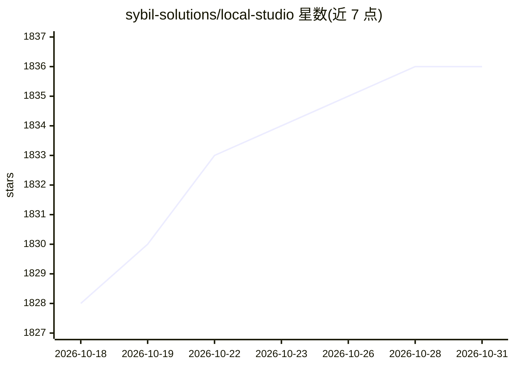

# sybil-solutions/local-studio

⭐ 1,836 · TypeScript · MIT · 推送 2026-10-26 · [GitHub](https://github.com/sybil-solutions/local-studio) · [官网](https://localstudio.ai) · 组织维护

**面向自托管模型的 T3 Code 桌面端：统一网关管理本机/局域网推理服务**

T3 Code 的 thin fork，面向运行自有模型的用户：内置本地控制器，可发现机器上的 vLLM、SGLang、llama.cpp 及任何提供 /v1/models 的推理服务，并通过单一 OpenAI/Anthropic 兼容网关暴露；支持在空闲 NVIDIA GPU 上启动固定 registry 配方，并经 Tailscale 组建跨机器 fleet，任意机器上的模型可被全部设备调用。桌面端提供 macOS/Windows/Linux 安装包，agent UI 等大部分功能来自上游 T3 Code，自身源码控制在 4,000 行以内以便跟随上游。

## 筛选速览

| 维度 | 判定 | 备注 |
|---|---|---|
| AI 角色 | `ai-ecosystem` | LLM/agent 周边工具 |
| 许可风险 | `permissive` | MIT |
| 部署形态 | `desktop` | 安装包/桌面程序 |
| 模型依赖 | local-ok | 支持本地模型 |
| 硬件要求 | — | 无带数字的原话,不猜 |
| 安装摩擦 | `low` | 无编译、无系统依赖或容器化 |
| 成熟度 | — | 结构信号不足 |

## 能力要点

- 自动发现 vLLM/SGLang/llama.cpp 等推理服务并统一为 OpenAI/Anthropic 兼容网关
- 通过 Tailscale 组建机器 fleet，跨机器调用已加载模型
- 可在空闲 NVIDIA GPU 上启动固定 registry 配方
- 提供 macOS 签名公证、Windows、Linux AppImage/.deb 安装包

## 适用场景

- 把本机或局域网多台机器上的自托管模型接入 T3 Code 使用
- 用手机/平板经 Tailscale 访问家里运行的本地模型
- 在一个面板里查看 fleet 中各机器的 GPU、已加载模型与用量

## 场景标签

`模型网关` · 领域:Agent 开发

## 证据(README 行号)

> L9: - **A bundled local controller.** It discovers the inference servers on each machine (vLLM, SGLang, llama.cpp, anyth
> L10: - **A machine fleet over Tailscale.** **Settings → Local** finds the devices on your tailnet and connects existing 
> L39: Every controller serves `/v1/models`, `/v1/chat/completions`, `/v1/completions`, `/v1/messages` and `/v1/responses`

## 星数曲线

2026-10-18 1,828 → 2026-10-31 1,836（+8）

---
*卡片 v1 · prompt 1.4 · 生成 2026-10-21 · 置信度 mid · 依据 README sha `96acb55944bb` · [字段定义](../../DATASET.md)*
