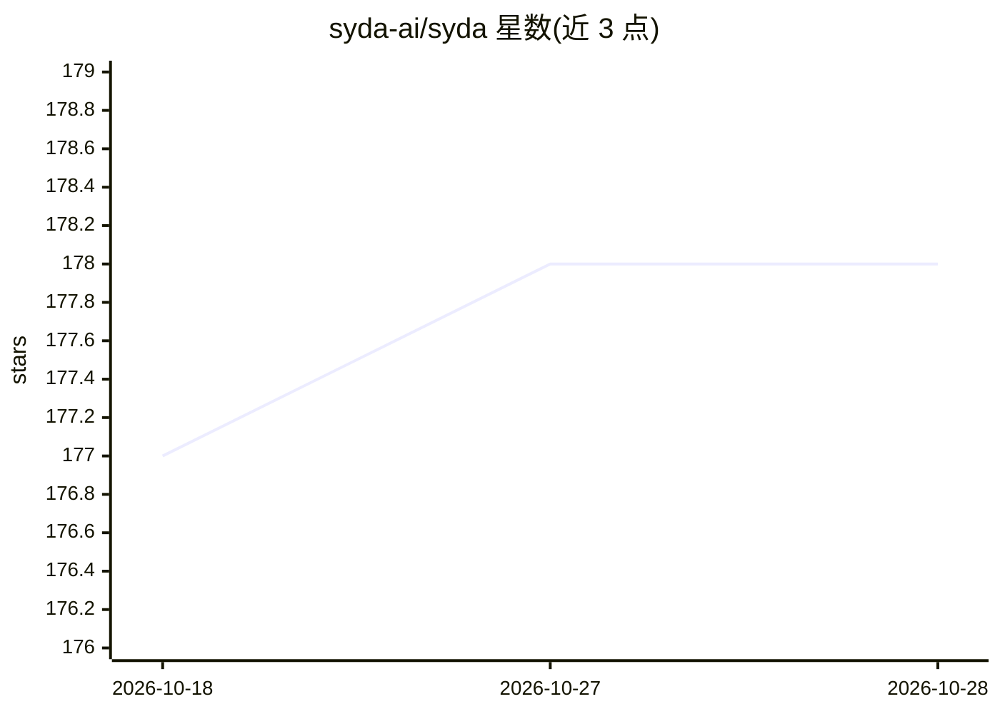

# syda-ai/syda

⭐ 178 · Python · MIT · 推送 2026-08-09 · [GitHub](https://github.com/syda-ai/syda) · [官网](https://python.syda.ai/) · 组织维护

**给开发者的 LLM 合成数据生成库：保持引用完整性的结构化表格与文档**

Python 库（CLI 同步提供），调用多提供商 LLM 生成合成测试数据：结构化表格（CSV）、非结构化文本、PDF/HTML 文档，通过 SQLAlchemy 模型、YAML/JSON schema 或既有数据库连接符推断 schema。生成时维护外键引用完整性，支持自定义生成器函数处理业务规则；codegen 模式让 LLM 一次调用生成 Python 生成函数以支撑百万级行数，附带每表成本追踪与 HTML 运行报告。支持 Claude/GPT/Gemini/Grok 及任何 OpenAI 兼容 API（Ollama/vLLM 等）。需要 LLM API key 运行。

## 筛选速览

| 维度 | 判定 | 备注 |
|---|---|---|
| AI 角色 | `ai-native` | 本体是模型或模型工具 |
| 许可风险 | `permissive` | MIT |
| 部署形态 | `library` | 以包/库形式分发 |
| 模型依赖 | local-ok | 支持本地模型 |
| 硬件要求 | — | 无带数字的原话,不猜 |
| 安装摩擦 | `low` | 无编译、无系统依赖或容器化 |
| 成熟度 | — | 结构信号不足 |

## 能力要点

- 外键引用完整性维护与按拓扑序写回数据库
- codegen 模式：10,000 行约 3 次 LLM 调用，函数缓存后重跑即时
- 支持 SQLAlchemy 模型/YAML/JSON/既有数据库作为 schema 来源
- CLI 覆盖 validate/generate/db infer，可接入 CI 流水线

## 适用场景

- 为测试环境生成不暴露敏感信息的模拟数据
- 从现有数据库 schema 直接生成合成数据并写回
- 生成与 CSV 数据内容一致的 PDF 产品目录等文档
- 大规模（千到百万行）合成数据集生成与成本控制

## 场景标签

`代码生成` · 领域:编码与开发

## 证据(README 行号)

> L12: SYDA seamlessly generates realistic synthetic test
> L52: |**Multi-AI Provider**|No vendor lock-in|Claude, GPT, Gemini, Grok, Ollama, and any OpenAI-compatible API|

## 星数曲线

2026-10-18 177 → 2026-10-28 178（+1）

---
*卡片 v1 · prompt 1.4 · 生成 2026-10-23 · 置信度 high · 依据 README sha `439e14b7af56` · [字段定义](../../DATASET.md)*
