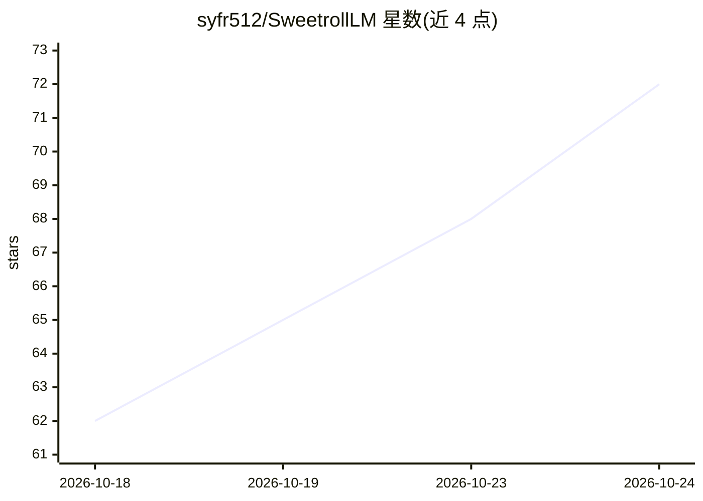

# syfr512/SweetrollLM

⭐ 73 · Python · AGPL-3.0 · 推送 2026-06-27 · [GitHub](https://github.com/syfr512/SweetrollLM) · 个人维护

**本地优先的桌面 AI 角色扮演聊天客户端，含 GGUF 推理与 agent 工作区**

面向终端用户的本地 AI 聊天客户端：提供 SillyTavern 式角色卡、世界书与人格功能，支持原生 llama-cpp-python 加载 GGUF 模型、托管 KoboldCPP 旧电脑回退后端，以及 Ollama 检测与 OpenAI 兼容云端 API 多槽位。附带 Agentic Workspace 本地工作区（文件夹会话、终端执行、后台服务管理、沙箱路径校验）、图片附件视觉描述、每聊天摘要记忆与 Hugging Face GGUF 市场下载。通过 git clone 加 install.bat/start.bat 在 Windows 上运行，数据存储于本地 storage/ 目录，AGPL-3.0 许可。

## 筛选速览

| 维度 | 判定 | 备注 |
|---|---|---|
| AI 角色 | `ai-native` | 本体是模型或模型工具 |
| 许可风险 | `viral` | AGPL-3.0 |
| 部署形态 | `desktop` | 安装包/桌面程序 |
| 模型依赖 | local-ok | 支持本地模型 |
| 硬件要求 | — | 无带数字的原话,不猜 |
| 安装摩擦 | `low` | 无编译、无系统依赖或容器化 |
| 成熟度 | — | 结构信号不足 |

## 能力要点

- 原生 GGUF 加载失败时自动回退托管 KoboldCPP 后端（适配无 AVX 旧 CPU）
- Ollama 一等支持：检测、模型列表、SSE 拉取进度、注册为 provider
- Agentic Workspace：文件工具、终端执行、自动化脚本与分级权限控制
- 角色卡/世界书/人格导入导出与每聊天自动摘要记忆

## 适用场景

- 在本机离线进行角色扮演聊天与管理 GGUF 模型
- 用本地 agent 工作区检查、创建和运行项目文件
- 在同一个客户端里切换本地推理与 OpenAI 兼容云端 API

## 场景标签

`聊天机器人` · 领域:对话与助手

## 证据(README 行号)

> L5: > A local-first AI tavern for character chat, GGUF inference, cloud providers, multimodal context, and a growing age
> L9: SweetrollLM is built for users searching for a local AI client, SillyTavern alternative, LM Studio alternative, offl
> L104: ### Agentic Workspace

## 星数曲线

2026-10-18 62 → 2026-10-24 72（+10）

---
*卡片 v1 · prompt 1.4 · 生成 2026-10-24 · 置信度 high · 依据 README sha `08b0fc1088d0` · [字段定义](../../DATASET.md)*
