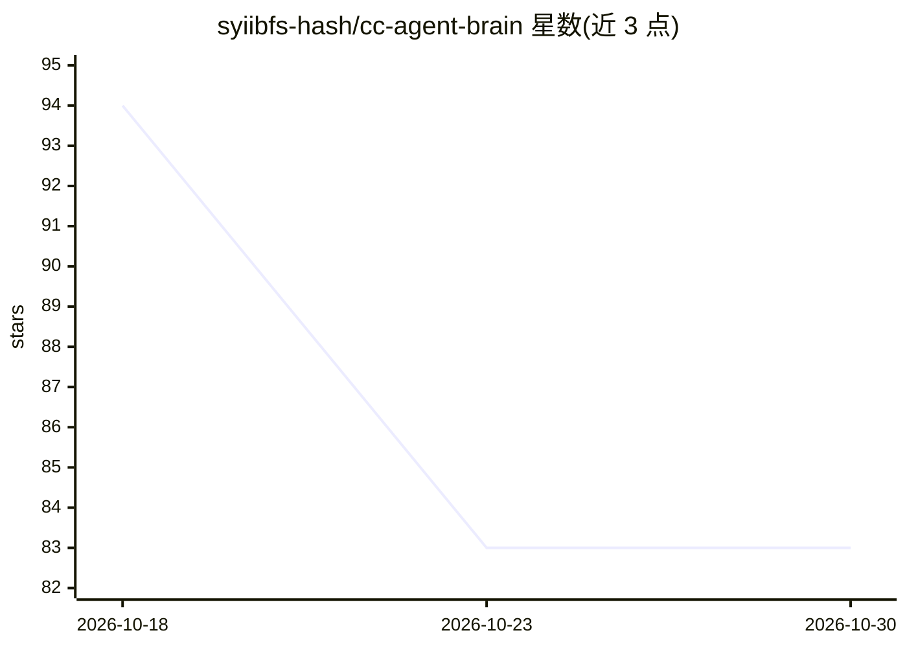

# syiibfs-hash/cc-agent-brain

⭐ 83 · Python · MIT · 推送 2026-09-04 · [GitHub](https://github.com/syiibfs-hash/cc-agent-brain) · 个人维护 · 中文 README

**编码 Agent 的本地记忆引擎：SQLite+FTS5 检索，MCP 暴露给各工具**

面向 Claude Code、Cursor、Codex 等编码 Agent 的本地优先记忆引擎：通过 6 个 Hook 自动捕获用户提示、助手回复与工具调用，写入 SQLite+FTS5 只增事件流，并蒸馏为四层（working/episodic/semantic/procedural）带版本的长期记忆，事实变更走取代/失效而非覆盖。仅用 Python 标准库，零第三方依赖，全程离线无遥测；以 MCP server 暴露给任意客户端，同时投影为 Markdown Wiki。以 git clone 加安装脚本方式集成到目标项目，不覆盖已有 .claude/ 目录。

## 筛选速览

| 维度 | 判定 | 备注 |
|---|---|---|
| AI 角色 | `ai-ecosystem` | LLM/agent 周边工具 |
| 许可风险 | `permissive` | MIT |
| 部署形态 | `None` |  |
| 模型依赖 | — | README 未给出锁定关系 |
| 硬件要求 | — | 无带数字的原话,不猜 |
| 安装摩擦 | `low` | 无编译、无系统依赖或容器化 |
| 成熟度 | — | 结构信号不足 |

## 能力要点

- Python 标准库 sqlite3+FTS5（BM25）实现，含中文 bigram 分词，零第三方依赖
- 四层记忆模型，每条记忆带状态、有效期、置信度、来源与取代链
- 6 Hooks + 6 Skills + 3 Agents 组件，覆盖捕获、召回、蒸馏、审计
- 捕获时对常见密钥形态脱敏，个人数据 git 忽略

## 适用场景

- 让 Claude Code 等 MCP 客户端跨会话记住工作过程与决策
- 离线检索中英文的项目记忆与 Wiki 投影
- 为多个编码工具共享同一份本地记忆库

## 场景标签

`Agent 记忆` · 领域:Agent 开发

## 证据(README 行号)

> L8: exposed to any tool through **MCP**. Installs as a namespaced add-on and never
> L38: - **MCP-native, tool-agnostic** — one memory store for every MCP client.
> L74: Full reference: `docs/memory-engine.md`, MCP setup:

## 星数曲线

2026-10-18 94 → 2026-10-30 83（-11）

---
*卡片 v1 · prompt 1.4 · 生成 2026-10-24 · 置信度 high · 依据 README sha `44c759f97a7c` · [字段定义](../../DATASET.md)*
