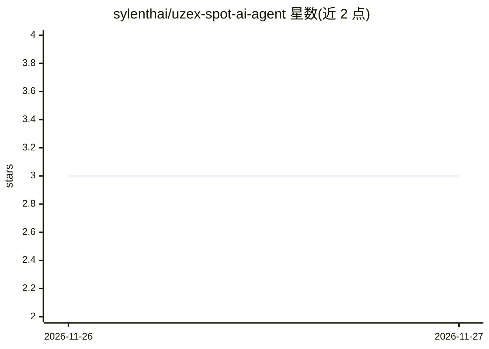

# sylenthai/uzex-spot-ai-agent

⭐ 3 · Python · Apache-2.0 · 推送 2026-11-21 · [GitHub](https://github.com/sylenthai/uzex-spot-ai-agent) · 个人维护

**面向乌兹别克斯坦商品交易所数据的零幻觉双语问答 AI 代理**

为乌兹别克斯坦共和国商品交易所（UZEX）提供查询服务的 AI 代理，提供 Telegram Bot 与 FastAPI REST 两种交付形式。索引 2022–2026 年 50 万条现货交易、6,616 份合同、14,392 家企业、120 家经纪机构，用 SQLite FTS5 建立全文索引（平均查询延迟约 11.5ms）。防幻觉机制：仅把 SQLite 检索到的真实事实传给 DeepSeek V3（temperature=0.0），数据库无记录时不调用 LLM、输出不含数字的固定拒绝回复；未配置 API key 或网络异常时自动回退到确定性 SQL 格式化器，可完全离线运行。

## 筛选速览

| 维度 | 判定 | 备注 |
|---|---|---|
| AI 角色 | `ai-native` | 本体是模型或模型工具 |
| 许可风险 | `permissive` | Apache-2.0 |
| 部署形态 | `library` | 以包/库形式分发 |
| 模型依赖 | locked-api |  |
| 硬件要求 | — | 无带数字的原话,不猜 |
| 安装摩擦 | `low` | 无编译、无系统依赖或容器化 |
| 成熟度 | — | 结构信号不足 |

## 能力要点

- SQLite FTS5 索引 50 万条交易，平均查询延迟约 11.5ms
- 零幻觉护栏：无记录时输出固定拒绝回复且不含任何数字
- DeepSeek V3 仅做基于检索事实的综合，数据库无结果时不调用 LLM
- 无 API key 或网络异常时自动回退确定性 SQL 格式化器，100% 离线可用

## 适用场景

- 用乌兹别克语或俄语查询交易所交易、合同、公司与经纪信息
- 查询商品价格、年度 top 买家/卖家与区域分析
- 部署为 Telegram Bot 或带 Swagger 文档的 REST 服务

## 场景标签

`聊天机器人` `数据分析` `RAG` · 领域:效率与自动化

## 证据(README 行号)

> L15: > **English Summary:** **UZEX Spot AI Agent** is a production-ready, zero-hallucination bilingual (Uzbek & Russian)
> L32: - **Faktik bog'liqlik:** DeepSeek ga faqat SQLite dan topilgan haqiqiy JSON faktlar uzatiladi (`temperature=0.0`). 

## 星数曲线

2026-11-26 3 → 2026-11-27 3（+0）

---
*卡片 v1 · prompt 1.4 · 生成 2026-11-26 · 置信度 mid · 依据 README sha `f2f584ffb730` · [字段定义](../../DATASET.md)*
