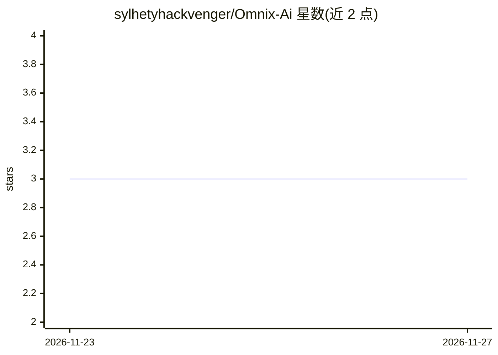

# sylhetyhackvenger/Omnix-Ai

⭐ 3 · Python · MIT · 推送 2026-10-24 · [GitHub](https://github.com/sylhetyhackvenger/Omnix-Ai) · 个人维护

**在 Android Termux 上以本地 Ollama 模型运行的自主 AI Agent**

单文件 Python 程序，将运行 Termux 的 Android 手机变为本地自主 AI Agent：以 Ollama 本地模型驱动，无云端调用、无 API key、无遥测。核心机制包括结构化 JSON 步骤循环（每回合调用一个工具）、自写插件并热加载、源码自编辑带语法校验与回滚、完成前强制 verify。工具集覆盖代码审计、CDP 浏览器自动化、手机控制（需 root 或 Termux:API）、离线 RAG 知识库与安全侦察（CVE 查询为只读）。定位为防御性助手，面向红队/蓝队/CTF 人员、移动研究者与开发者。

## 筛选速览

| 维度 | 判定 | 备注 |
|---|---|---|
| AI 角色 | `ai-native` | 本体是模型或模型工具 |
| 许可风险 | `permissive` | MIT |
| 部署形态 | `library` | 以包/库形式分发 |
| 模型依赖 | local-ok | 支持本地模型 |
| 硬件要求 | — | 无带数字的原话,不猜 |
| 安装摩擦 | `low` | 无编译、无系统依赖或容器化 |
| 成熟度 | — | 结构信号不足 |

## 能力要点

- 本地 Ollama 模型驱动，无云端调用与 API key
- 自扩展：写入新 Python 插件并实时加载；自编辑源码带备份与 /rollback
- 离线 RAG 知识库：BM25 检索、多格式文档摄取、OCR、英↔孟加拉词典
- 防御性安全设计：危险命令拦截、紧急号码硬拒、消息/支付类操作二次确认

## 适用场景

- CTF 中在本地设备上整理 nmap 输出、关联 CVE
- 授权渗透测试中保存扫描产物并盘点本机工具
- 在手机上用本地模型逐行审计自己的代码库
- 从书籍和 PDF 构建个人离线知识库

## 场景标签

`浏览器自动化` `RAG` `网络安全` `OCR` · 领域:效率与自动化

## 证据(README 行号)

> L14: **Omnix-Ai** — a fully autonomous, self-extending AI operator that lives inside Termux.
> L22: **Omnix-Ai** is a *singular Python file* that turns any rooted-or-not Android phone running Termux into an autonomo
> L33: |**Local-first LLM**|Runs on `huihui_ai/qwen2.5-coder-abliterate:1.5b` (configurable) via Ollama. No cloud calls.|

## 星数曲线

2026-11-23 3 → 2026-11-27 3（+0）

---
*卡片 v1 · prompt 1.4 · 生成 2026-11-23 · 置信度 mid · 依据 README sha `049298e7eb72` · [字段定义](../../DATASET.md)*
