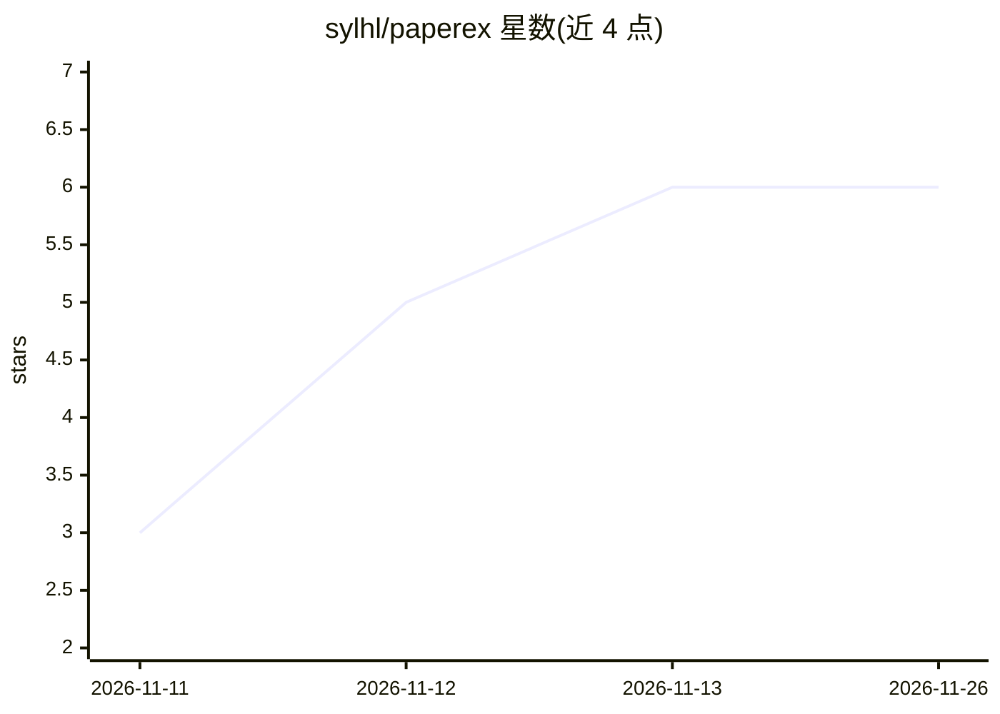

# sylhl/paperex

⭐ 6 · Python · AGPL-3.0 · 推送 2026-11-15 · [GitHub](https://github.com/sylhl/paperex) · 个人维护 · 中文 README

**给论文阅读者：把英文 PDF 原位翻译成可对照阅读的中文 PDF**

本地优先的学术论文原位翻译与双语阅读器：擦除 PDF 可替换文字层后按原 bbox 回填中文，公式、表格、图片、算法与参考文献进入保护区保留原位；按版面 profile 与语义角色分类（标题/正文/图注等）采取不同策略，内置 1066 条术语库注入上下文，翻译缓存分桶复用。QA 在隔离子进程中做文本级与页面级检查，输出 qa.json，standard/strict 模式带修复循环，每轮严格变好才接受。提供 Windows 安装包；macOS/Linux 需从源码运行。翻译文本会发送到所配置的模型服务商。

## 筛选速览

| 维度 | 判定 | 备注 |
|---|---|---|
| AI 角色 | `ai-native` | 本体是模型或模型工具 |
| 许可风险 | `viral` | AGPL-3.0 |
| 部署形态 | `desktop` | 安装包/桌面程序 |
| 模型依赖 | local-ok | 支持本地模型 |
| 硬件要求 | — | 无带数字的原话,不猜 |
| 安装摩擦 | `medium` | 含编译或系统依赖之一 |
| 成熟度 | — | 结构信号不足 |

## 能力要点

- 原位重排：中文按原 bbox 回填，保留分栏、缩进与字号层级，输出仍是标准 PDF
- 保护区分层：公式/表格/图片/算法/参考文献不送模型不改写，行内公式以哨兵占位符还原
- 四档质量模式与隔离 QA 子进程，输出机器可读 qa.json，strict 模式自动修复循环
- 翻译缓存按协议/地址/模型/语言/引擎版本/术语指纹分桶

## 适用场景

- 左右对照阅读英文论文的中文 PDF
- 翻译需要保留公式与版式的学术 PDF
- 对翻译结果做自动质检与修复后人工抽查

## 场景标签

`科研工具` · 领域:学习与行业

## 证据(README 行号)

> L3: > 本地优先的学术论文原位翻译与双语阅读器：保留公式、图表与版式，把英文 PDF 变成可左右对照阅读的中文 PDF。
> L15:  把一篇英文论文的 PDF **原地**翻译成中文：只擦除可替换的文字层，公式、图表、算法、参考文献与版式保持原位，再用中文字体在原文的 bbox 里重排。翻译后的文件仍然是标准 PDF，可以批注、检索、打印；在 paperex 
> L79: 1. **结构分析**：识别论文版面（ICLR / NeurIPS / ACL / Springer / Nature 等 profile），把文本块分类为 `title / heading / body / caption / 

## 星数曲线

2026-11-11 3 → 2026-11-26 6（+3）

---
*卡片 v1 · prompt 1.4 · 生成 2026-11-20 · 置信度 mid · 依据 README sha `30e36f85f0d1` · [字段定义](../../DATASET.md)*
