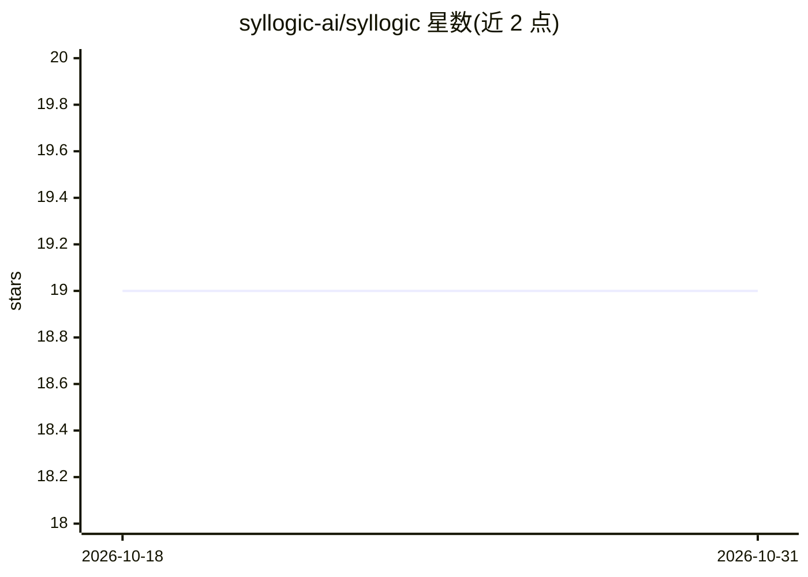

# syllogic-ai/syllogic

⭐ 19 · TypeScript · AGPL-3.0 · 推送 2026-10-27 · [GitHub](https://github.com/syllogic-ai/syllogic) · [官网](https://syllogic.ai/) · 组织维护

**自托管个人财务看板：AI 分类、订阅追踪与 CSV 导入**

面向自托管用户的开源个人财务应用：跟踪余额、现金流、经常性支出与投资持仓，支持 CSV 导入导出、转账/报销关联与分类分析。AI 交易分类为可选功能，通过 OpenAI API（默认 GPT-4o-mini）实现，未设置时回退到基于关键词的匹配（70% 置信阈值）。附带 MCP 服务器供兼容的 LLM 客户端读取财务数据。技术栈为 Next.js 前端 + FastAPI 后端 + PostgreSQL/Redis，提供 Docker Compose、Railway 一键部署与 CasaOS 方式，另有公开在线演示。AGPL-3.0 许可。

## 筛选速览

| 维度 | 判定 | 备注 |
|---|---|---|
| AI 角色 | `ai-enhanced` | 去掉 AI 部分产品仍成立 |
| 许可风险 | `viral` | AGPL-3.0 |
| 部署形态 | `self-host` | docker 或自建部署 |
| 模型依赖 | — | README 未给出锁定关系 |
| 硬件要求 | — | 无带数字的原话,不猜 |
| 安装摩擦 | `low` | 无编译、无系统依赖或容器化 |
| 成熟度 | — | 结构信号不足 |

## 能力要点

- 可选的 OpenAI 交易分类，未配置时回退关键词匹配
- 经常性支出与订阅识别追踪
- MCP 服务器：兼容 LLM 客户端读取持仓与财务数据
- Docker/Railway/CasaOS 多种自托管部署路径

## 适用场景

- 在自己的服务器上管理家庭账户、余额与消费趋势
- 识别并追踪订阅与经常性扣费
- 导入银行 CSV 对账单并保持数据可导出

## 场景标签

 · 领域:个人财务/自托管应用

## 证据(README 行号)

> L29: Syllogic is an open-source personal finance app for self-hosters who want control over their data without giving up
> L47: - **AI categorization**: optional OpenAI-powered categorization with rule-based fallback
> L36: - Use AI categorization only if it helps your workflow

## 星数曲线

2026-10-18 19 → 2026-10-31 19（+0）

---
*卡片 v1 · prompt 1.4 · 生成 2026-10-28 · 置信度 high · 依据 README sha `bb42e0639353` · [字段定义](../../DATASET.md)*
