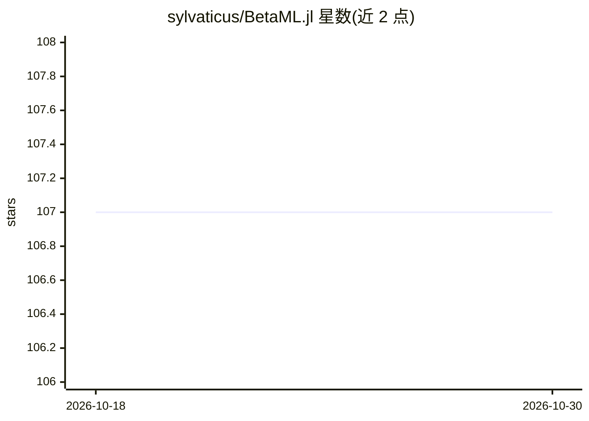

# sylvaticus/BetaML.jl

⭐ 107 · Julia · MIT · 推送 2026-10-01 · [GitHub](https://github.com/sylvaticus/BetaML.jl) · 个人维护

**Julia 实现的机器学习算法工具包，供教学与研究使用**

纯 Julia 编写的机器学习算法库，模型全部在本仓库内实现而非第三方封装，覆盖感知机、决策树、随机森林、神经网络、混合高斯、K-Means/K-Medoids 聚类、缺失值填补（含随机森林填补）、PCA/自编码器降维、混淆矩阵与特征重要性等。多数模型提供 MLJ 接口，经 juliacall/JuliaCall 也可在 Python 和 R 中使用。定位偏教学与研究而非计算效率：全部模型仅 CPU 运行且数据须装入内存；配套教程文档、算法理论笔记与 JOSS 论文。维护者欢迎贡献，重点接受清晰易读的代码。

## 筛选速览

| 维度 | 判定 | 备注 |
|---|---|---|
| AI 角色 | `ai-native` | 本体是模型或模型工具 |
| 许可风险 | `permissive` | MIT |
| 部署形态 | `None` |  |
| 模型依赖 | — | README 未给出锁定关系 |
| 硬件要求 | — | 无带数字的原话,不猜 |
| 安装摩擦 | `low` | 无编译、无系统依赖或容器化 |
| 成熟度 | — | 结构信号不足 |

## 能力要点

- 模型全部为纯 Julia 实现，非第三方封装
- 覆盖分类/回归/聚类/填补/降维/预测分析等算法族
- 提供 MLJ 接口，可经 juliacall/JuliaCall 在 Python/R 中调用
- 带详注教程文档与配套算法理论笔记

## 适用场景

- 在 Julia 中完成教学或研究用的机器学习工作流
- 从 Python/R 调用纯 Julia 实现的经典 ML 算法
- 学习算法内部实现（代码以易读为取向）

## 场景标签

`教程课程` · 领域:学习与行业

## 证据(README 行号)

> L50: All models are implemented entirely in Julia and are hosted in the repository itself (i.e. they are not wrappers of
> L94: The focus of the library is skewed toward user-friendliness rather than computational efficiency. While the code is

## 星数曲线

2026-10-18 107 → 2026-10-30 107（+0）

---
*卡片 v1 · prompt 1.4 · 生成 2026-10-23 · 置信度 high · 依据 README sha `435f0da5cab1` · [字段定义](../../DATASET.md)*
