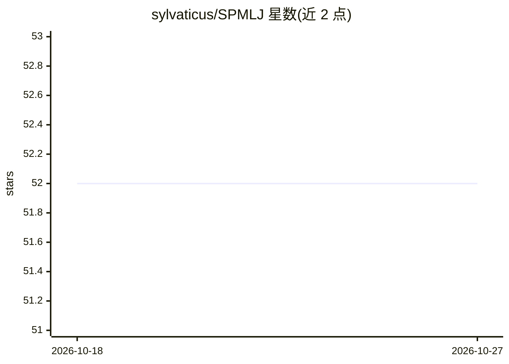

# sylvaticus/SPMLJ

⭐ 52 · Julia · CC-BY-4.0 · 推送 2026-09-30 · [GitHub](https://github.com/sylvaticus/SPMLJ) · [官网](https://sylvaticus.github.io/SPMLJ/stable) · 个人维护

**Julia 科学编程与机器学习入门课程（视频+代码+练习）**

基于 GitHub 的协作式入门课程，主题为使用 Julia 语言完成常见科学计算与机器学习任务，由视频、代码和练习组成。仓库存放课程页面源码（lessonSource 目录），学习者可 git clone 获取并自行运行代码，或访问在线课程页面。课程提供贡献指南，允许社区协作完善内容。

## 筛选速览

| 维度 | 判定 | 备注 |
|---|---|---|
| AI 角色 | `ai-knowledge` | 知识聚合/清单类 |
| 许可风险 | `viral` | CC-BY-4.0 |
| 部署形态 | `None` |  |
| 模型依赖 | — | README 未给出锁定关系 |
| 硬件要求 | — | 无带数字的原话,不猜 |
| 安装摩擦 | `low` | 无编译、无系统依赖或容器化 |
| 成熟度 | — | 结构信号不足 |

## 能力要点

- 覆盖 Julia 科学编程与机器学习任务
- 提供视频、代码与练习三种形式
- 课程页面源码开放于 lessonSource 目录

## 适用场景

- 跟随视频课程学习 Julia 科学编程
- 在机器学习入门中动手运行与练习代码
- 参与贡献完善课程内容

## 场景标签

`教程课程` · 领域:学习与行业

## 证据(README 行号)

> L3: A GitHub-based, collaborative introductory course on common scientific-related and machine learning tasks using the 
> L4: With videos, code and exercises.

## 星数曲线

2026-10-18 52 → 2026-10-27 52（+0）

---
*卡片 v1 · prompt 1.4 · 生成 2026-10-24 · 置信度 high · 依据 README sha `fba1547ce2d4` · [字段定义](../../DATASET.md)*
