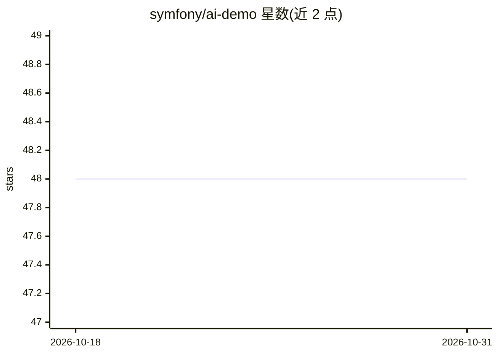

# symfony/ai-demo

⭐ 48 · PHP · MIT · 推送 2026-10-26 · [GitHub](https://github.com/symfony/ai-demo) · [官网](https://symfony.com/packages/ai-demo) · 组织维护

**Symfony AI 组件的官方演示应用：聊天机器人等 11 个示例**

Symfony 官方组织维护的演示应用，展示 Symfony AI 组件的用法：基于 Twig LiveComponent 的聊天界面、PostgreSQL+pgvector 向量存储的博客上下文检索，共 11 个使用场景，另含 MCP 服务器演示（current-time 工具与 Movies MCP App）与面向编码代理的 AI Mate CLI。技术栈为 PHP 8.4、Symfony 8.1、OpenAI GPT 与 Embeddings，通过 Docker Compose 与 FrankenPHP 运行，需自备 OpenAI API Key。定位是供开发者学习与试验组件集成，而非生产应用。

## 筛选速览

| 维度 | 判定 | 备注 |
|---|---|---|
| AI 角色 | `ai-ecosystem` | LLM/agent 周边工具 |
| 许可风险 | `permissive` | MIT |
| 部署形态 | `self-host` | docker 或自建部署 |
| 模型依赖 | — | README 未给出锁定关系 |
| 硬件要求 | — | 无带数字的原话,不猜 |
| 安装摩擦 | `low` | 无编译、无系统依赖或容器化 |
| 成熟度 | — | 结构信号不足 |

## 能力要点

- 11 个 AI 使用场景（聊天、图像裁剪、OCR、语音等）
- PostgreSQL+pgvector 存储与索引博客上下文
- 内置 MCP 服务器演示（工具与 MCP App）
- AI Mate CLI 供编码代理读取 Symfony 项目 AI 配置

## 适用场景

- 学习如何在 Symfony 项目中集成 AI 组件
- 体验并调试 Symfony AI 的聊天与 RAG 流程
- 作为自建 Symfony AI 应用的起点模板

## 场景标签

`聊天机器人` `RAG` `OCR` `教程课程` · 领域:对话与助手

## 证据(README 行号)

> L3: Symfony application demoing Symfony AI components.
> L133: * The chatbot application is a simple and small Symfony 8.1 application.

## 星数曲线

2026-10-18 48 → 2026-10-31 48（+0）

---
*卡片 v1 · prompt 1.4 · 生成 2026-10-25 · 置信度 mid · 依据 README sha `0a7e6dddf415` · [字段定义](../../DATASET.md)*
