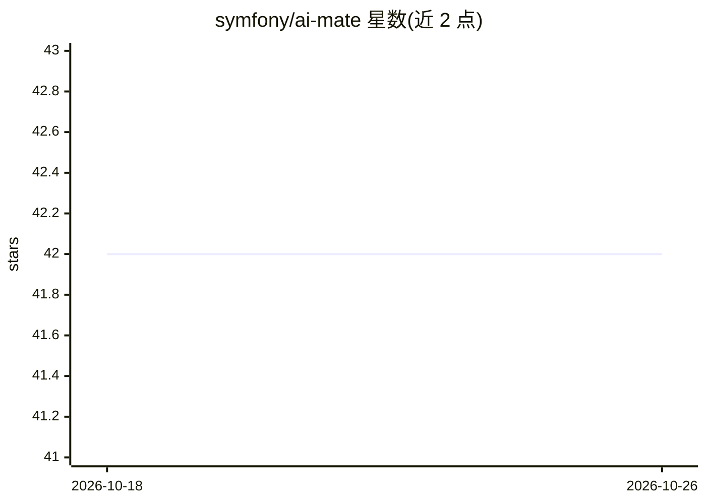

# symfony/ai-mate

⭐ 42 · PHP · MIT · 推送 2026-10-23 · [GitHub](https://github.com/symfony/ai-mate) · [官网](https://symfony.com/packages/ai-mate) · 组织维护

**Symfony 项目的 CLI 开发助手：为编码 agent 暴露项目感知工具**

Symfony 官方 Mate 组件，提供命令行工具 vendor/bin/mate，将项目感知的开发工具（profiler 资源读取、调试、技能安装等）暴露给编码 agent（Claude Code、Codex、Cursor 等）与开发者。Agent 直接执行 mate 命令，工具 schema 通过 --help/tools:inspect 按需读取而非预加载；支持 --format=json 机器可读输出。附带 composer 插件，在 composer install/update 后自动刷新扩展发现。README 声明这是开发工具，不用于生产环境。通过 composer require --dev 安装。

## 筛选速览

| 维度 | 判定 | 备注 |
|---|---|---|
| AI 角色 | `ai-ecosystem` | LLM/agent 周边工具 |
| 许可风险 | `permissive` | MIT |
| 部署形态 | `None` |  |
| 模型依赖 | — | README 未给出锁定关系 |
| 硬件要求 | — | 无带数字的原话,不猜 |
| 安装摩擦 | `low` | 无编译、无系统依赖或容器化 |
| 成熟度 | — | 结构信号不足 |

## 能力要点

- CLI 工具暴露 Symfony profiler 读取、调试与技能管理等开发工具
- 工具 schema 按需读取（--help / tools:inspect），非预加载
- --format=json 机器可读输出，面向编码 agent 集成
- 附带 composer 插件，install/update 后自动刷新扩展发现

## 适用场景

- 让 Claude Code / Cursor 等编码 agent 直接调用 Symfony 项目调试与 profiler 工具
- 开发者通过 CLI 查询与调用 Symfony 项目感知的开发工具
- 为编码 agent 生成集成指令文件（AGENT_INSTRUCTIONS.md）

## 场景标签

 · 领域:开发工具/PHP 生态

## 证据(README 行号)

> L3: The Mate component provides a command-line assistant (`vendor/bin/mate`) that exposes
> L4: project-aware development tools to coding agents (Claude Code, Codex, Cursor, …) and
> L6: via `--help`/`tools:inspect` instead of being loaded up front. This is a development tool,

## 星数曲线

2026-10-18 42 → 2026-10-26 42（+0）

---
*卡片 v1 · prompt 1.4 · 生成 2026-10-25 · 置信度 high · 依据 README sha `580024a57917` · [字段定义](../../DATASET.md)*
