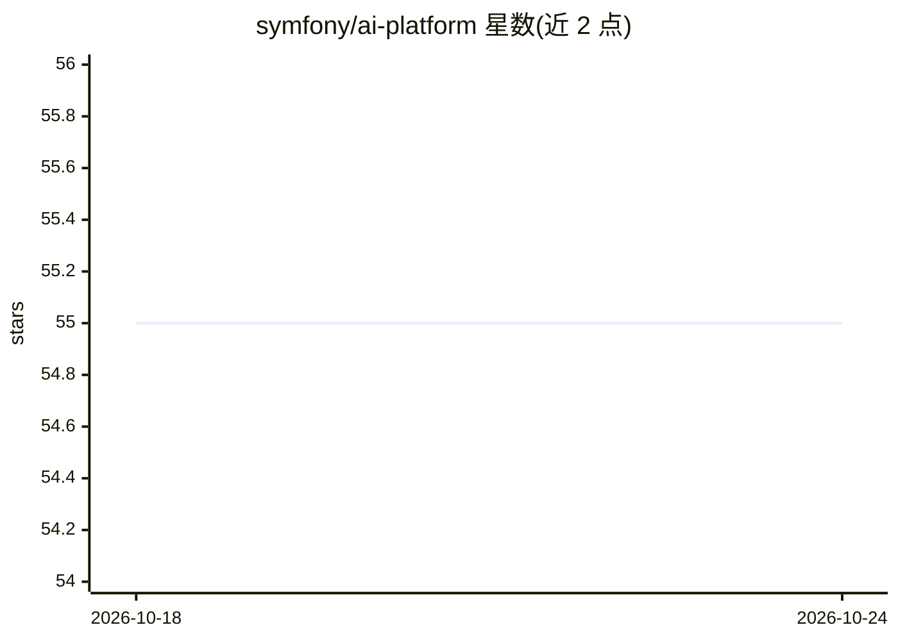

# symfony/ai-platform

⭐ 55 · PHP · MIT · 推送 2026-10-23 · [GitHub](https://github.com/symfony/ai-platform) · [官网](https://symfony.com/packages/ai-platform) · 组织维护

**Symfony 的 AI 平台抽象组件：统一对接多种模型服务商**

PHP 库，为 Symfony 生态提供与各 AI 模型平台交互的抽象层，通过独立 bridge 包接入 40 余个平台（Anthropic、Azure、Bedrock、Ollama、OpenAI 等），并附带 Cache、Failover、Decision 等基础设施型 bridge。本体声明为实验性组件，不受 Symfony 向后兼容承诺覆盖。本仓库为只读 sub-tree split，问题与 PR 提交到主仓库 symfony/ai。

## 筛选速览

| 维度 | 判定 | 备注 |
|---|---|---|
| AI 角色 | `ai-ecosystem` | LLM/agent 周边工具 |
| 许可风险 | `permissive` | MIT |
| 部署形态 | `None` |  |
| 模型依赖 | local-ok | 支持本地模型 |
| 硬件要求 | — | 无带数字的原话,不猜 |
| 安装摩擦 | `low` | 无编译、无系统依赖或容器化 |
| 成熟度 | `idea` | |

## 能力要点

- 40+ 平台的 bridge 包体系
- Cache/Failover/Decision 等基础设施 bridge
- Composer 一条命令安装核心组件
- 覆盖本地运行时（Ollama/LM Studio/Docker Model Runner）与云端服务商

## 适用场景

- 在 Symfony/PHP 应用中统一接入多家 AI 服务商
- 为 PHP 项目构建可切换后端的 AI 功能
- 配合 Failover/Cache bridge 做服务容错与结果缓存

## 场景标签

`模型网关` · 领域:Agent 开发

## 证据(README 行号)

> L3: The Platform component provides an abstraction for interacting with different models, their providers and contracts.
> L18: To use a specific AI platform, install the corresponding bridge package:

## 星数曲线

2026-10-18 55 → 2026-10-24 55（+0）

---
*卡片 v1 · prompt 1.4 · 生成 2026-10-24 · 置信度 high · 依据 README sha `15d1ea51a5de` · [字段定义](../../DATASET.md)*
