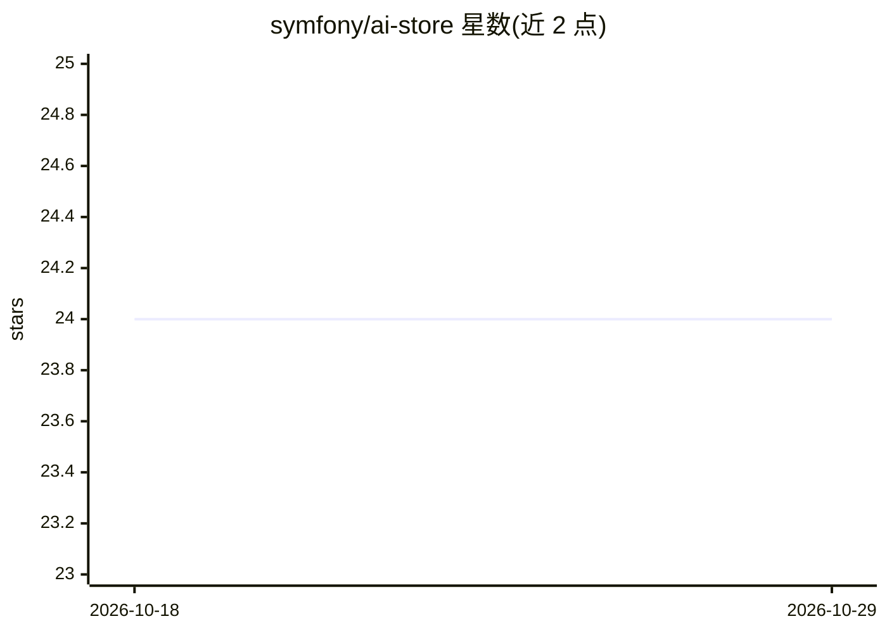

# symfony/ai-store

⭐ 24 · PHP · MIT · 推送 2026-10-26 · [GitHub](https://github.com/symfony/ai-store) · [官网](https://symfony.com/packages/ai-store) · 组织维护

**向量存储的 PHP 抽象层组件，统一文档存取接口**

Symfony AI 生态的 Store 组件：为在向量存储中存取文档提供低层抽象，通过独立的 bridge 包接入具体后端，官方列出 AWS S3 Vectors、Azure AI Search、ChromaDB、ClickHouse、Milvus、Qdrant、Weaviate 等 20 余种向量存储。以 composer 包形式安装。组件标注为 experimental，实验特性不受 Symfony 向后兼容承诺覆盖；本仓库为只读子树拆分，问题与 PR 需提交至主仓库。

## 筛选速览

| 维度 | 判定 | 备注 |
|---|---|---|
| AI 角色 | `ai-ecosystem` | LLM/agent 周边工具 |
| 许可风险 | `permissive` | MIT |
| 部署形态 | `None` |  |
| 模型依赖 | — | README 未给出锁定关系 |
| 硬件要求 | — | 无带数字的原话,不猜 |
| 安装摩擦 | `low` | 无编译、无系统依赖或容器化 |
| 成熟度 | `idea` | |

## 能力要点

- 面向向量存储文档存取的低层抽象
- 20 余个 bridge 包对接具体向量存储后端
- composer require symfony/ai-store 安装

## 适用场景

- PHP/Symfony 项目中统一接口接入多种向量存储
- 构建 RAG 或语义检索应用时管理文档向量
- 切换或组合不同向量数据库后端而少改业务代码

## 场景标签

`向量数据库` · 领域:知识与检索

## 证据(README 行号)

> L3: The Store component provides a low-level abstraction for storing and retrieving documents in a vector store.
> L18: To use a specific vector store, install the corresponding bridge package:

## 星数曲线

2026-10-18 24 → 2026-10-29 24（+0）

---
*卡片 v1 · prompt 1.4 · 生成 2026-10-27 · 置信度 high · 依据 README sha `6fd730cbd3f0` · [字段定义](../../DATASET.md)*
