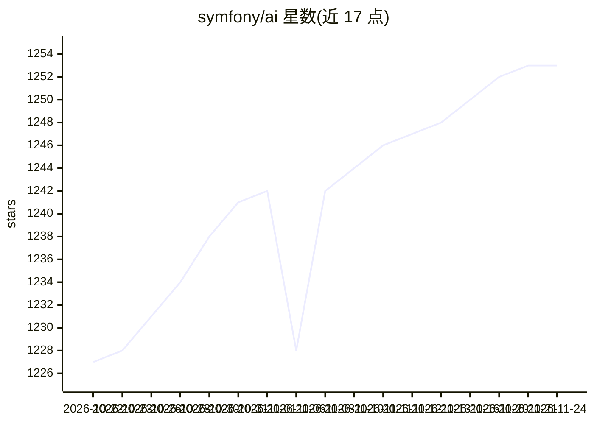

# symfony/ai

⭐ 1,253 · PHP · MIT · 推送 2026-11-22 · [GitHub](https://github.com/symfony/ai) · [官网](https://ai.symfony.com/) · 组织维护

**为 PHP/Symfony 应用集成 AI 能力的组件集**

Symfony AI 由多个低层与高层组件及对应 Symfony Bundle 组成：Agent 组件提供构建可与用户交互并执行任务的 AI agent 的框架；Platform 提供访问多种 AI 平台的统一接口；Store 提供带索引与检索的数据存储抽象；Mate 是让编码 agent 通过项目感知工具检查运行中 PHP 应用的命令行助手。另含 AI Bundle 与 MCP Bundle，后者基于官方 MCP SDK 使应用可充当 MCP 服务器或客户端。提供示例代码与完整 Symfony 演示应用。

## 筛选速览

| 维度 | 判定 | 备注 |
|---|---|---|
| AI 角色 | `ai-ecosystem` | LLM/agent 周边工具 |
| 许可风险 | `permissive` | MIT |
| 部署形态 | `None` |  |
| 模型依赖 | — | README 未给出锁定关系 |
| 硬件要求 | — | 无带数字的原话,不猜 |
| 安装摩擦 | `low` | 无编译、无系统依赖或容器化 |
| 成熟度 | — | 结构信号不足 |

## 能力要点

- Platform 组件统一接口接入 OpenAI、Anthropic、Azure、Gemini、VertexAI 等平台
- Agent 组件提供构建 AI agent 的框架
- Store 组件提供带索引与检索的数据存储抽象
- MCP Bundle 集成官方 MCP SDK，支持作为 MCP 服务器或客户端

## 适用场景

- 在 PHP/Symfony 应用中接入多家 AI 平台
- 构建能执行任务的 AI agent
- 为 AI 应用实现向量存储与检索
- 让应用充当 MCP 服务器或客户端

## 场景标签

`Agent 框架` `模型网关` `RAG` · 领域:Agent 开发

## 证据(README 行号)

> L5: Symfony AI is a set of components that integrate AI capabilities into PHP applications.
> L12:  * **Agent**: Framework for building AI agents that can interact with users and perform tasks.
> L14:  * **Platform**: A unified interface to various AI platforms like OpenAI, Anthropic, Azure, Gemini, VertexAI, and m

## 星数曲线

2026-10-22 1,227 → 2026-11-24 1,253（+26）

---
*卡片 v1 · prompt 1.4 · 生成 2026-11-23 · 置信度 high · 依据 README sha `4918d35ba6b2` · [字段定义](../../DATASET.md)*
