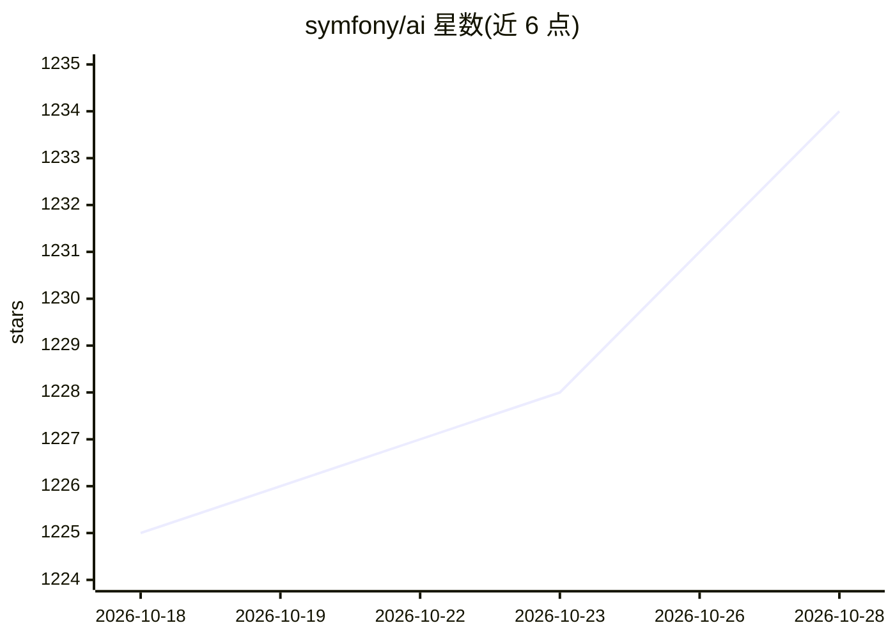

# symfony/ai

⭐ 1,234 · PHP · MIT · 推送 2026-10-27 · [GitHub](https://github.com/symfony/ai) · [官网](https://ai.symfony.com/) · 组织维护

**为 PHP 应用集成 AI 能力的 Symfony 组件与 Bundle 集合**

Symfony 官方维护的 PHP AI 组件库，提供 Agent（构建可与用户交互并执行任务的智能体框架）、Chat（统一消息接口与长期上下文存储）、Mate（让编码 agent 通过项目感知工具检查运行中 PHP 应用的命令行助手）、Platform（对接 OpenAI/Anthropic/Azure/Gemini/VertexAI 等平台的统一接口）、Store（带索引与检索的数据存储抽象）等组件，并附 AI Bundle 与 MCP Bundle 用于 Symfony 框架集成，后者基于官方 MCP SDK 可作为 MCP 服务器或客户端。面向使用 Symfony 框架的 PHP 开发者，提供示例与演示应用。

## 筛选速览

| 维度 | 判定 | 备注 |
|---|---|---|
| AI 角色 | `ai-ecosystem` | LLM/agent 周边工具 |
| 许可风险 | `permissive` | MIT |
| 部署形态 | `None` |  |
| 模型依赖 | — | README 未给出锁定关系 |
| 硬件要求 | — | 无带数字的原话,不猜 |
| 安装摩擦 | `low` | 无编译、无系统依赖或容器化 |
| 成熟度 | — | 结构信号不足 |

## 能力要点

- Platform 组件统一接口对接 OpenAI、Anthropic、Azure、Gemini、VertexAI 等多种 AI 平台
- Agent 框架用于构建可与用户交互并执行任务的 AI 智能体
- MCP Bundle 基于官方 MCP SDK，支持作为 MCP 服务器或客户端
- Store 组件提供面向 AI 应用的数据存储抽象与索引检索

## 适用场景

- 在 Symfony PHP 应用中接入多家 AI 平台的模型能力
- 构建带长期上下文存储的 AI agent 对话应用
- 将 PHP 应用封装为 MCP 服务器或客户端参与 agent 生态

## 场景标签

`Agent 框架` `模型网关` · 领域:Agent 开发

## 证据(README 行号)

> L5: Symfony AI is a set of components that integrate AI capabilities into PHP applications.
> L15:  * **Platform**: A unified interface to various AI platforms like OpenAI, Anthropic, Azure, Gemini, VertexAI, and m

## 星数曲线

2026-10-18 1,225 → 2026-10-28 1,234（+9）

---
*卡片 v1 · prompt 1.4 · 生成 2026-10-21 · 置信度 high · 依据 README sha `614a13b1ebe5` · [字段定义](../../DATASET.md)*
