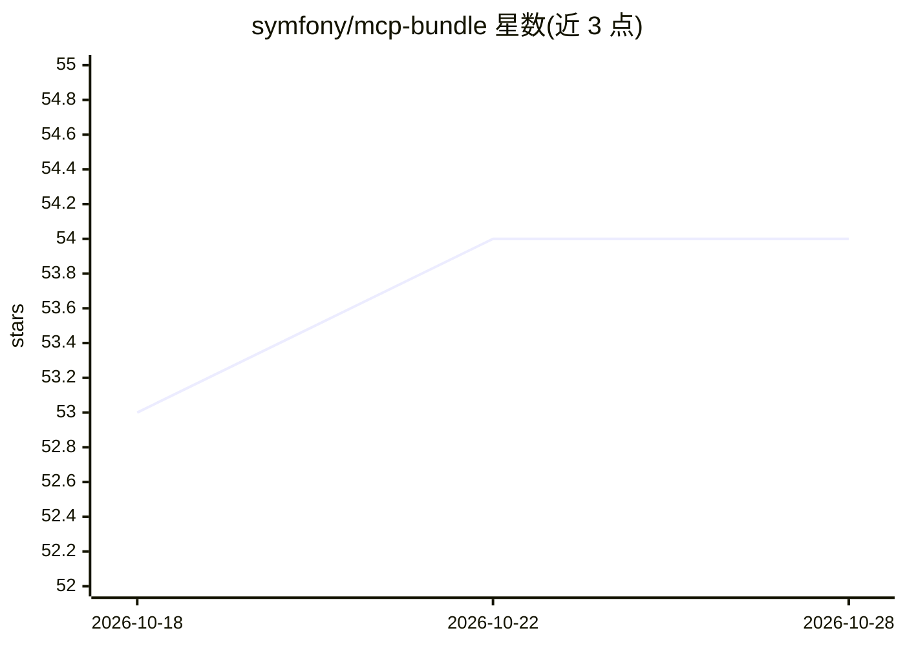

# symfony/mcp-bundle

⭐ 54 · PHP · MIT · 推送 2026-10-27 · [GitHub](https://github.com/symfony/mcp-bundle) · [官网](https://symfony.com/packages/mcp-bundle) · 组织维护

**Symfony 的 Model Context Protocol 集成 Bundle（服务端+客户端）**

基于官方 MCP SDK（mcp/sdk）的 Symfony 集成包，使 Symfony 应用可作为 MCP 服务端暴露 tools、prompts、resources 与 resource templates，也可作为 MCP 客户端连接其他 MCP 服务器，传输方式支持 HTTP 或 STDIO。通过 composer 安装。README 声明该 Bundle 处于实验阶段，实验特性不在 Symfony 向后兼容承诺范围内。仓库为只读子树拆分，issue 与 PR 需提交至 symfony/ai 主仓库。

## 筛选速览

| 维度 | 判定 | 备注 |
|---|---|---|
| AI 角色 | `ai-ecosystem` | LLM/agent 周边工具 |
| 许可风险 | `permissive` | MIT |
| 部署形态 | `None` |  |
| 模型依赖 | — | README 未给出锁定关系 |
| 硬件要求 | — | 无带数字的原话,不猜 |
| 安装摩擦 | `low` | 无编译、无系统依赖或容器化 |
| 成熟度 | `idea` | |

## 能力要点

- 作为 MCP 服务端暴露 tools/prompts/resources/resource templates
- 可作为 MCP 客户端连接其他 MCP 服务器
- HTTP 与 STDIO 两种传输方式
- 基于官方 MCP SDK mcp/sdk

## 适用场景

- 为 Symfony 应用暴露 MCP 工具供 AI 客户端调用
- Symfony 应用作为 MCP 客户端接入其他 MCP 服务器
- 在 Symfony 技术栈中构建 MCP 服务

## 场景标签

 · 领域:Web 开发框架/AI 协议集成

## 证据(README 行号)

> L3: Symfony integration bundle for Model Context Protocol using the official
> L6: Act as an MCP server that exposes tools, prompts, resources and resource templates, and as an MCP client

## 星数曲线

2026-10-18 53 → 2026-10-28 54（+1）

---
*卡片 v1 · prompt 1.4 · 生成 2026-10-24 · 置信度 high · 依据 README sha `d05bd8cf9b82` · [字段定义](../../DATASET.md)*
