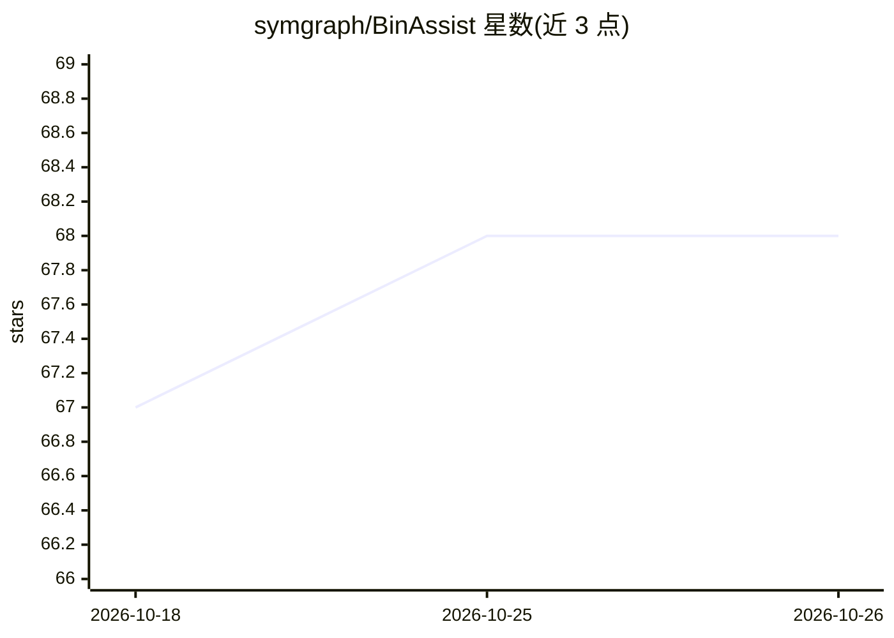

# symgraph/BinAssist

⭐ 68 · Python · MIT · 推送 2026-09-20 · [GitHub](https://github.com/symgraph/BinAssist) · 个人维护

**Binary Ninja 的 LLM 逆向分析插件：函数解释、重命名建议与语义图**

面向逆向工程人员的 Binary Ninja 插件，通过本地或远程 LLM 辅助二进制分析：在多 IL 层级解释函数与指令、以对话与 ReAct Agent 方式自主多步分析、生成函数/变量重命名与类型和结构体建议（带置信度）、构建 GraphRAG 语义图并做污点分析的漏洞检测。支持任何 OpenAI v1 兼容或 Anthropic API，兼容 Ollama、LM Studio、OpenAI、AWS Bedrock（经 LiteLLM）等；经 MCP 协议提供可扩展工具。要求 Binary Ninja 4000+ 与 Python 3.8+，Linux 为主要开发平台，Windows/macOS 未经充分测试。

## 筛选速览

| 维度 | 判定 | 备注 |
|---|---|---|
| AI 角色 | `ai-native` | 本体是模型或模型工具 |
| 许可风险 | `permissive` | MIT |
| 部署形态 | `library` | 以包/库形式分发 |
| 模型依赖 | local-ok | 支持本地模型 |
| 硬件要求 | — | 无带数字的原话,不猜 |
| 安装摩擦 | `medium` | 含编译或系统依赖之一 |
| 成熟度 | — | 结构信号不足 |

## 能力要点

- 函数/变量重命名、重类型与结构体生成建议，含置信度评分
- ReAct Agent 自主多步逆向分析（最多 15 次迭代，经 MCP 调用工具）
- GraphRAG 语义图：函数摘要、社区聚类与源到汇污点分析
- 兼容任何 OpenAI v1 兼容或 Anthropic API 端点

## 适用场景

- 逆向时快速理解未知函数与指令的用途
- 批量获得有语义的函数/变量命名并选择性应用
- 在大体积二进制中定位危险 API 与漏洞路径
- 用自然语言提问让 Agent 自主探索二进制行为

## 场景标签

`知识图谱` `网络安全` · 领域:知识与检索

## 证据(README 行号)

> L4: _A comprehensive LLM-powered Binary Ninja plugin for intelligent binary analysis and reverse engineering._
> L8: BinAssist is an advanced LLM plugin designed to enhance binary analysis and reverse engineering workflows through in
> L10: The plugin supports any OpenAI v1-compatible or Anthropic API, making it compatible with popular LLM providers incl

## 星数曲线

2026-10-18 67 → 2026-10-26 68（+1）

---
*卡片 v1 · prompt 1.4 · 生成 2026-10-24 · 置信度 mid · 依据 README sha `690a86069f61` · [字段定义](../../DATASET.md)*
