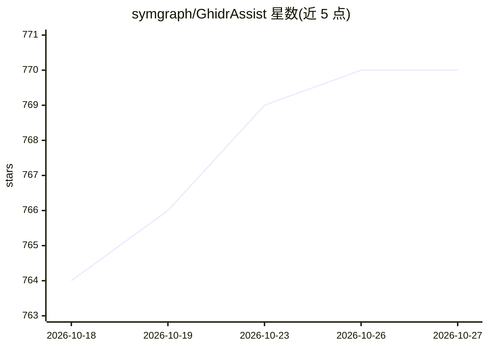

# symgraph/GhidrAssist

⭐ 770 · Java · MIT · 推送 2026-10-16 · [GitHub](https://github.com/symgraph/GhidrAssist) · 个人维护

**Ghidra 的 LLM 插件：逆向工程中的代码解释与智能分析**

Ghidra 逆向工程平台的多标签页 LLM 插件：提供反汇编/伪 C 代码解释、多轮对话、自定义查询，以及基于 5 层语义层次（语句→基本块→函数→模块→二进制）的 Graph-RAG 知识图谱——预计算 LLM 摘要存于 SQLite+JGraphT，重复查询无需调用 LLM。另含 Leiden 社区检测模块发现、安全特征提取（网络/文件/加密 API 与风险分级）、ReAct 自主调查模式、MCP 工具调用与函数改名/导航等操作。兼容任意 OpenAI v1 API，本地（Ollama/LM Studio/Open-WebUI）与云端（OpenAI/Anthropic/Azure）均可，需 Ghidra ≥11.0，MIT 许可。

## 筛选速览

| 维度 | 判定 | 备注 |
|---|---|---|
| AI 角色 | `ai-native` | 本体是模型或模型工具 |
| 许可风险 | `permissive` | MIT |
| 部署形态 | `None` |  |
| 模型依赖 | local-ok | 支持本地模型 |
| 硬件要求 | — | 无带数字的原话,不猜 |
| 安装摩擦 | `low` | 无编译、无系统依赖或容器化 |
| 成熟度 | — | 结构信号不足 |

## 能力要点

- 5 层语义层次的 Graph-RAG：预计算摘要支持无 LLM 的快速查询与离线浏览
- 安全特征提取：网络/文件 I/O/加密 API 检测与 LOW/MEDIUM/HIGH 风险分级
- ReAct Agentic 模式自主调查（Think-Act-Observe、todo 跟踪）
- 兼容任意 OpenAI v1-compatible API（本地与云端提供商）

## 适用场景

- 逆向分析时让 LLM 解释函数、指令与反编译伪 C 代码
- 通过语义知识图谱离线浏览已索引函数与安全标注
- 让 ReAct agent 自主排查漏洞与调用链
- 借助 function calling 批量重命名变量与改进分析

## 场景标签

`RAG` `网络安全` · 领域:知识与检索

## 证据(README 行号)

> L8: GhidrAssist integrates Large Language Models (LLMs) into Ghidra to provide intelligent assistance for binary explora
> L13: * **Code Explanation** - Explain functions and instructions in both disassembly and decompiled pseudo-C
> L16: * **Interactive Chat** - Multi-turn conversational queries with persistent chat history

## 星数曲线

2026-10-18 764 → 2026-10-27 770（+6）

---
*卡片 v1 · prompt 1.4 · 生成 2026-10-22 · 置信度 high · 依据 README sha `a96e6824bd3a` · [字段定义](../../DATASET.md)*
