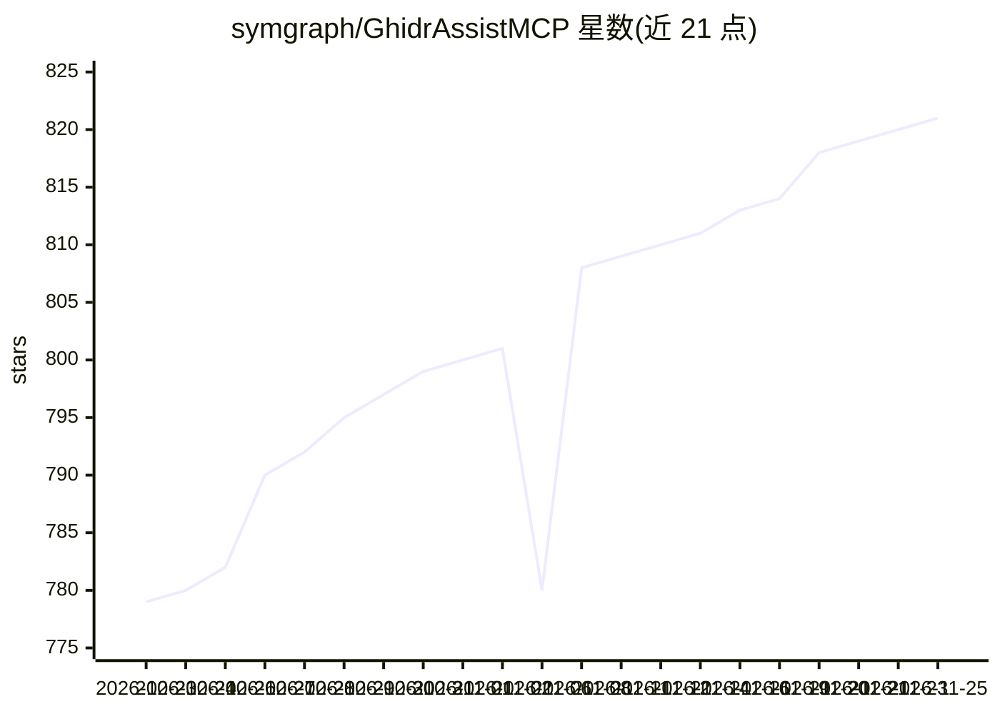

# symgraph/GhidrAssistMCP

⭐ 821 · Java · MIT · 推送 2026-11-23 · [GitHub](https://github.com/symgraph/GhidrAssistMCP) · 个人维护

**让 AI 助手通过 MCP 协议操作 Ghidra 逆向工程能力的扩展**

以 Ghidra 扩展形式实现的 MCP 服务器，通过官方 SDK 暴露 103 个显式工具（默认启用 96 个），覆盖项目生命周期、函数/伪代码/反汇编读取、交叉引用、注释、类型与结构体修改、分析任务管理等操作；支持 SSE 与 Streamable HTTP 两种传输、6 个资源模板与 7 个预置分析提示词，提供结果缓存、异步任务与多程序/多窗口支持。安装需 Ghidra 12.0-12.2 与 Java 25+，可下载 ZIP 或从源码 Gradle 构建，亦可在 analyzeHeadless 无头模式启动。

## 筛选速览

| 维度 | 判定 | 备注 |
|---|---|---|
| AI 角色 | `ai-ecosystem` | LLM/agent 周边工具 |
| 许可风险 | `permissive` | MIT |
| 部署形态 | `desktop` | 安装包/桌面程序 |
| 模型依赖 | — | README 未给出锁定关系 |
| 硬件要求 | — | 无带数字的原话,不猜 |
| 安装摩擦 | `medium` | 含编译或系统依赖之一 |
| 成熟度 | — | 结构信号不足 |

## 能力要点

- 103 个显式 MCP 工具（默认启用 96 个），含读写注解与输入契约
- 支持 SSE 与 Streamable HTTP 两种传输方式
- 6 个 MCP 资源模板与 7 个预置逆向分析提示词
- 支持 GUI 多窗口共享服务器与 analyzeHeadless 无头模式启动

## 适用场景

- 让 AI 助手读取反汇编/伪代码并辅助逆向分析
- 自动化脚本通过标准化 API 批量操作 Ghidra 项目与程序
- 在无头 Ghidra 环境中为 agent 提供二进制分析接口

## 场景标签

`网络安全` · 领域:学习与行业

## 证据(README 行号)

> L3: A powerful Ghidra extension that provides an MCP (Model Context Protocol) server, enabling AI assistants and other t
> L9: GhidrAssistMCP bridges the gap between AI-powered analysis tools and Ghidra's comprehensive reverse engineering plat
> L13: - **MCP Server Integration**: Full Model Context Protocol server implementation using official SDK

## 星数曲线

2026-10-23 779 → 2026-11-25 821（+42）

---
*卡片 v1 · prompt 1.4 · 生成 2026-11-25 · 置信度 high · 依据 README sha `c9e95b1e0b0d` · [字段定义](../../DATASET.md)*
