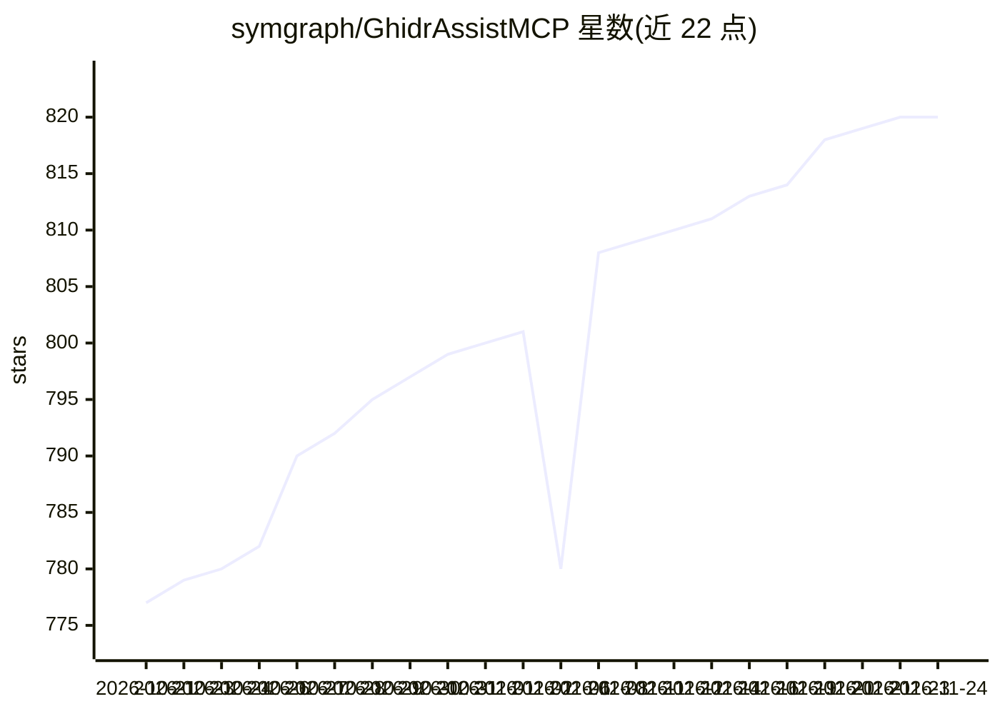

# symgraph/GhidrAssistMCP

⭐ 821 · Java · MIT · 推送 2026-11-23 · [GitHub](https://github.com/symgraph/GhidrAssistMCP) · 组织维护

**让 AI 助手通过 MCP 调用 Ghidra 逆向工程能力的扩展**

以 Ghidra 扩展形式提供的原生 MCP 服务器：通过官方 SDK 实现协议，提供 101 个显式工具（默认启用 94 个）、6 个资源模板和 7 个预置分析提示词，覆盖函数、反编译伪代码、交叉引用、类型/结构体、注释与项目管理等操作。支持 SSE 与 Streamable HTTP 双传输、多程序/多窗口共享、结果缓存、异步任务与实时日志，可在 GUI 或 analyzeHeadless 无头模式下运行。需要 Ghidra 12.0–12.2 与 Java 25+。

## 筛选速览

| 维度 | 判定 | 备注 |
|---|---|---|
| AI 角色 | `ai-ecosystem` | LLM/agent 周边工具 |
| 许可风险 | `permissive` | MIT |
| 部署形态 | `desktop` | 安装包/桌面程序 |
| 模型依赖 | — | README 未给出锁定关系 |
| 硬件要求 | — | 无带数字的原话,不猜 |
| 安装摩擦 | `medium` | 含编译或系统依赖之一 |
| 成熟度 | — | 结构信号不足 |

## 能力要点

- 101 个显式 MCP 工具，带读写注解与可单独启停管理
- SSE 与 Streamable HTTP 双传输，支持多程序与多窗口共享
- 支持 analyzeHeadless 无头模式启动，并提供 agent_lab 沙箱配置文件
- 结果缓存、异步任务管理与实时请求日志

## 适用场景

- 在逆向分析中让 AI 助手读取伪代码、反汇编与交叉引用
- 通过 MCP 客户端批量重命名变量、设置类型与结构体
- 在无头 Ghidra 环境中为自动化分析流水线提供 MCP 接入
- 管理 Ghidra 项目生命周期（创建/打开/保存/关闭）

## 场景标签

`网络安全` · 领域:学习与行业

## 证据(README 行号)

> L3: A powerful Ghidra extension that provides an MCP (Model Context Protocol) server, enabling AI assistants and other t
> L13: - **MCP Server Integration**: Full Model Context Protocol server implementation using official SDK
> L15: - **101 Explicit Tools**: Discoverable operation names with precise input contracts and read/write annotations (94 

## 星数曲线

2026-10-21 777 → 2026-11-24 820（+43）

---
*卡片 v1 · prompt 1.4 · 生成 2026-11-24 · 置信度 high · 依据 README sha `b14945a8d40f` · [字段定义](../../DATASET.md)*
