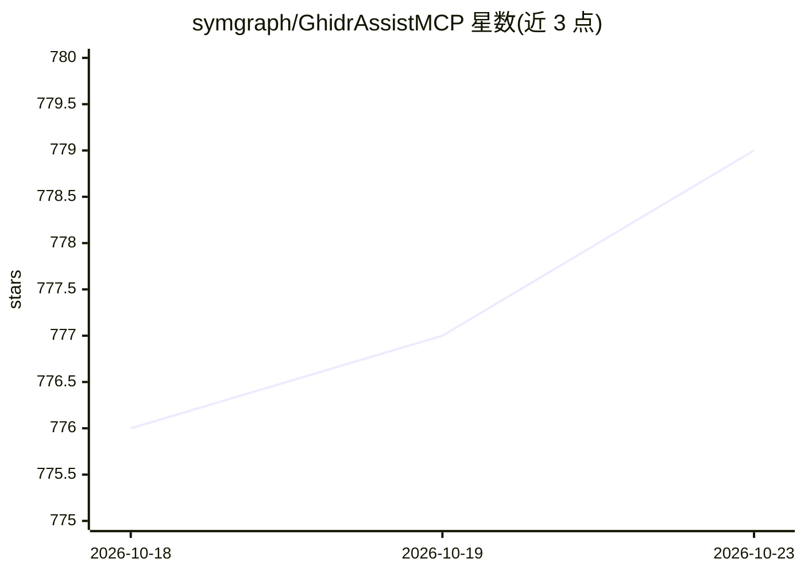

# symgraph/GhidrAssistMCP

⭐ 779 · Java · MIT · 推送 2026-10-09 · [GitHub](https://github.com/symgraph/GhidrAssistMCP) · 个人维护

**为 Ghidra 提供 MCP 服务器的扩展：让 AI 助手操作逆向分析**

Ghidra 扩展，内嵌 Model Context Protocol 服务器（官方 SDK 实现，SSE 与 Streamable HTTP 双传输），使外部 AI 助手、自动化分析工具与脚本可通过标准化 API 调用 Ghidra 的逆向分析能力。提供 100 个显式工具（93 默认启用）、6 个资源模板与 7 个预置分析 prompt，覆盖项目生命周期、函数/反编译/交叉引用读写、结构体与类型、分析控制等；支持多程序、多窗口共享运行时、异步任务与结果缓存，并可通过 analyzeHeadless 以 headless 模式启动。面向使用 Ghidra 做逆向工程并希望接入 AI 客户端的开发者；要求 Ghidra 12.0/12.1 Public 与 Java 25 或更新版本。

## 筛选速览

| 维度 | 判定 | 备注 |
|---|---|---|
| AI 角色 | `ai-ecosystem` | LLM/agent 周边工具 |
| 许可风险 | `permissive` | MIT |
| 部署形态 | `desktop` | 安装包/桌面程序 |
| 模型依赖 | — | README 未给出锁定关系 |
| 硬件要求 | — | 无带数字的原话,不猜 |
| 安装摩擦 | `medium` | 含编译或系统依赖之一 |
| 成熟度 | — | 结构信号不足 |

## 能力要点

- 100 个显式 MCP 工具（93 默认启用），带读写标注与参数契约
- SSE 与 Streamable HTTP 双传输，官方 MCP SDK 实现
- 支持 analyzeHeadless 无界面模式启动 MCP 服务器
- 多程序/多窗口共享运行时与活动上下文感知

## 适用场景

- 让 AI 助手通过 MCP 直接读写 Ghidra 的函数、反编译与交叉引用
- 在无界面环境中以 headless 模式为 agent 提供二进制分析服务
- 通过 MCP 客户端自动化批量逆向分析流程

## 场景标签

`网络安全` · 领域:学习与行业

## 证据(README 行号)

> L3: A powerful Ghidra extension that provides an MCP (Model Context Protocol) server, enabling AI assistants and other t
> L9: GhidrAssistMCP bridges the gap between AI-powered analysis tools and Ghidra's comprehensive reverse engineering plat
> L15: - **100 Explicit Tools**: Discoverable operation names with precise input contracts and read/write annotations (93 

## 星数曲线

2026-10-18 776 → 2026-10-23 779（+3）

---
*卡片 v1 · prompt 1.4 · 生成 2026-10-22 · 置信度 high · 依据 README sha `03f23123e61d` · [字段定义](../../DATASET.md)*
