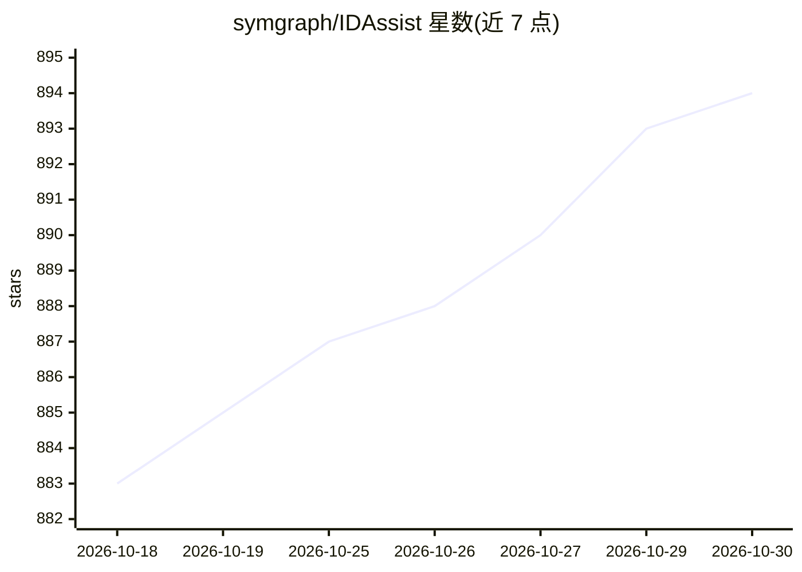

# symgraph/IDAssist

⭐ 894 · Python · MIT · 推送 2026-09-20 · [GitHub](https://github.com/symgraph/IDAssist) · 个人维护

**为逆向工程师提供 IDA Pro 内 LLM 辅助二进制分析插件**

基于 Python 与 PySide6 的 IDA Pro 9.0+ 插件，以可停靠面板形式集成多种 LLM 提供商（Anthropic、OpenAI、Ollama、LiteLLM、AWS Bedrock 等）。功能包括反编译函数的自然语言解释与安全分析、交互式问答、AI 改名建议回写 IDB、二进制语义知识图谱构建、RAG 文档检索、ReAct Agent 模式与 MCP 工具集成。需 IDA Pro 9.0+ 与 PySide6，推荐配合 Hex-Rays 反编译器使用；可通过 IDA Plugin Manager 或手动解压安装。

## 筛选速览

| 维度 | 判定 | 备注 |
|---|---|---|
| AI 角色 | `ai-native` | 本体是模型或模型工具 |
| 许可风险 | `permissive` | MIT |
| 部署形态 | `desktop` | 安装包/桌面程序 |
| 模型依赖 | local-ok | 支持本地模型 |
| 硬件要求 | — | 无带数字的原话,不猜 |
| 安装摩擦 | `low` | 无编译、无系统依赖或容器化 |
| 成熟度 | — | 结构信号不足 |

## 能力要点

- 函数解释含风险等级、安全标志与 API 检测
- AI 改名建议带置信度并可回写 IDB
- 二进制级语义知识图谱（可视化、语义搜索、社区检测）
- 支持 ReAct Agent、MCP 服务器与 LLM 函数调用

## 适用场景

- 在 IDA 内直接让 LLM 解释反编译函数与安全特征
- 批量获取函数/变量改名建议并选择性应用
- 构建并检索整个二进制的函数关系知识图谱
- 上传参考文档作为问答的 RAG 上下文

## 场景标签

`知识图谱` `RAG` `网络安全` · 领域:知识与检索

## 证据(README 行号)

> L9: IDAssist is an IDA Pro plugin that integrates LLM-powered analysis directly into IDA's interface, providing AI-assis
> L17: **Function Explanation** — Generate detailed natural-language explanations of decompiled functions with automatic s
> L11: Built with Python and PySide6, IDAssist runs as a dockable panel inside IDA Pro 9.0+ and communicates with LLM prov

## 星数曲线

2026-10-18 883 → 2026-10-30 894（+11）

---
*卡片 v1 · prompt 1.4 · 生成 2026-10-21 · 置信度 mid · 依据 README sha `b6e3ee632b2c` · [字段定义](../../DATASET.md)*
