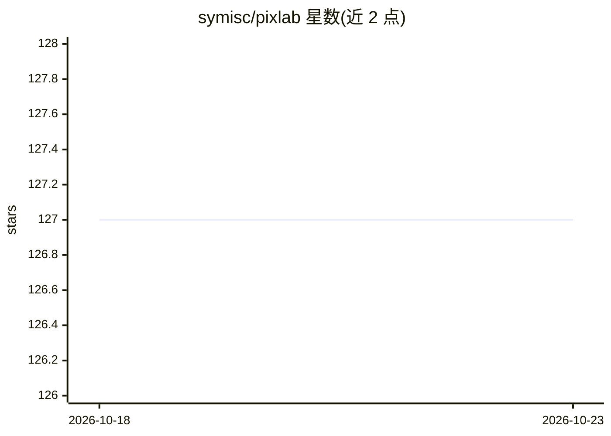

# symisc/pixlab

⭐ 127 · Python · BSD-2-Clause · 推送 2026-05-24 · [GitHub](https://github.com/symisc/pixlab) · [官网](https://pixlab.io) · 组织维护

**PixLab/FACEIO 官方教程、公告与代码示例集**

PixLab 与 FACEIO 产品线的官方资源仓库：以文章列表形式汇集 150 余篇指南与公告，覆盖 FACEIO 面部识别认证集成（React/Vue/Svelte/Next.js 等多种前端栈）、DOCSCAN 证件扫描与 KYC API、NSFW 图像过滤、人脸检测模糊、PixLab Annotate 图像标注工具、AI 照片编辑器等产品，并指向 pixlab.io/examples 的多语言示例代码集。读者可复制运行示例以熟悉 PixLab REST API。仓库本身不含可安装的软件。

## 筛选速览

| 维度 | 判定 | 备注 |
|---|---|---|
| AI 角色 | `ai-knowledge` | 知识聚合/清单类 |
| 许可风险 | `permissive` | BSD-2-Clause |
| 部署形态 | `None` |  |
| 模型依赖 | — | README 未给出锁定关系 |
| 硬件要求 | — | 无带数字的原话,不猜 |
| 安装摩擦 | `low` | 无编译、无系统依赖或容器化 |
| 成熟度 | — | 结构信号不足 |

## 能力要点

- 150 余篇 FACEIO/PixLab 产品教程与公告索引
- 覆盖多前端框架（React/Vue/Svelte/Next.js/HTMX）的人脸认证集成指南
- 指向 pixlab.io/examples 的多语言工作代码示例集

## 适用场景

- 查找在自有网站中集成 FACEIO 人脸认证的教程
- 了解 DOCSCAN 证件扫描/KYC API 的接入方式
- 参考 PixLab 图像处理 API 的多语言示例代码

## 场景标签

`教程课程` `人脸识别` `图像视频处理` · 领域:学习与行业

## 证据(README 行号)

> L1: # PixLab & FACEIO Guides, Announcments & Tutorials
> L140: # PixLab Resources & Code Samples

## 星数曲线

2026-10-18 127 → 2026-10-23 127（+0）

---
*卡片 v1 · prompt 1.4 · 生成 2026-10-23 · 置信度 high · 依据 README sha `20dd1688172a` · [字段定义](../../DATASET.md)*
