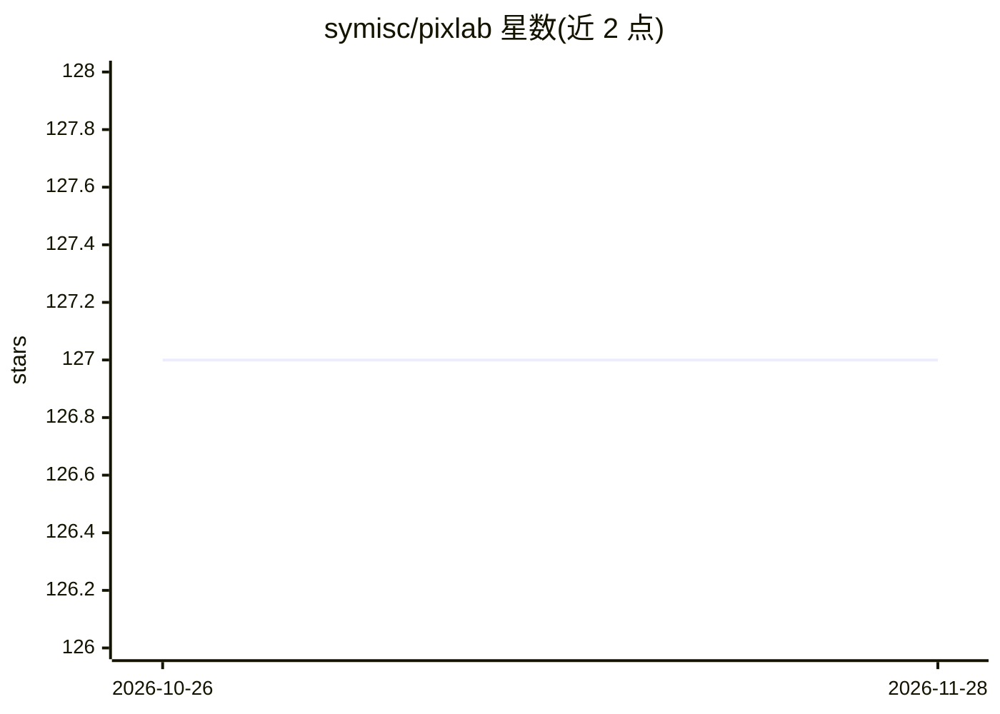

# symisc/pixlab

⭐ 127 · Python · BSD-2-Clause · 推送 2026-11-22 · [GitHub](https://github.com/symisc/pixlab) · [官网](https://pixlab.io) · 组织维护

**PixLab/FACEIO API 的教程与代码示例聚合页**

PixLab 官方维护的资源与示例索引页，汇总公司博客公告、产品发布信息，并链接到 PixLab API 的示例集（pixlab.io/examples）、API 端点列表与参考文档。覆盖面包括人脸识别认证（FACEIO/fio.js）、证件扫描（DOCSCAN）、图像标注、背景移除、OCR、NSFW 过滤等 API 的多语言（Python/PHP/Java/JavaScript）教程代码。内容形式为教程与示例代码，供开发者熟悉 PixLab API 使用；页面本身不含可安装的产品本体。

## 筛选速览

| 维度 | 判定 | 备注 |
|---|---|---|
| AI 角色 | `ai-knowledge` | 知识聚合/清单类 |
| 许可风险 | `permissive` | BSD-2-Clause |
| 部署形态 | `None` |  |
| 模型依赖 | — | README 未给出锁定关系 |
| 硬件要求 | — | 无带数字的原话,不猜 |
| 安装摩擦 | `low` | 无编译、无系统依赖或容器化 |
| 成熟度 | — | 结构信号不足 |

## 能力要点

- 链接多语言（Python/PHP/Java/JavaScript）API 示例代码集
- 汇总人脸认证、ID 扫描、OCR、标注等 API 教程
- 提供 5 分钟入门、端点列表与 API 参考文档入口

## 适用场景

- 查找 PixLab API 各端点的示例代码入门
- 在 React/Vue/Next.js 项目中集成人脸认证教程
- 了解 PixLab/FACEIO 产品线的功能范围

## 场景标签

`教程课程` · 领域:学习与行业

## 证据(README 行号)

> L145: # PixLab Resources & Code Samples
> L148: The Sample Set are practical usage, working code available in various programming languages intended to familiariz
> L150: * The PixLab API in 5 minutes or less.

## 星数曲线

2026-10-26 127 → 2026-11-28 127（+0）

---
*卡片 v1 · prompt 1.4 · 生成 2026-11-28 · 置信度 mid · 依据 README sha `121c0019d871` · [字段定义](../../DATASET.md)*
