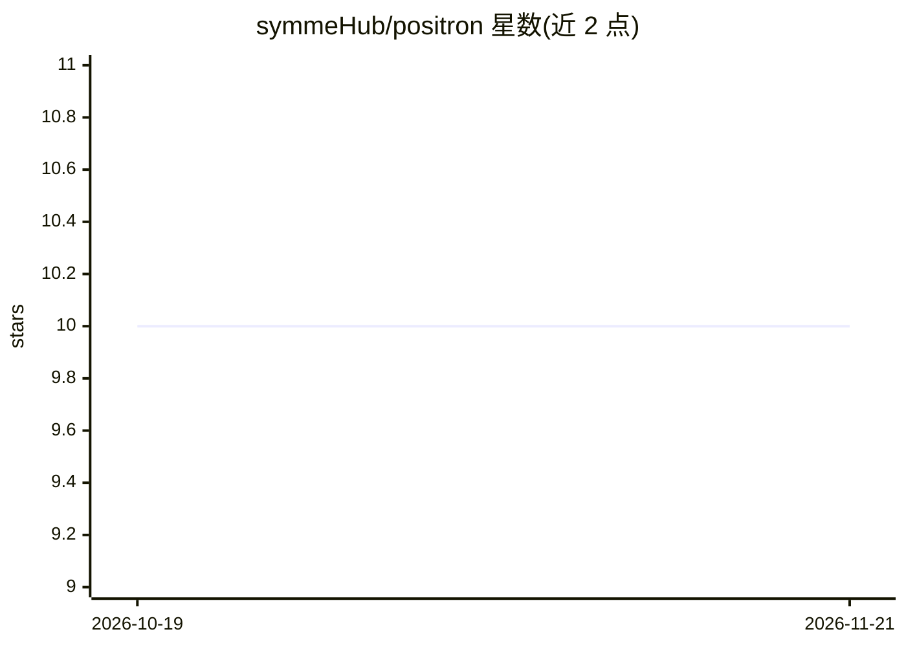

# symmeHub/positron

⭐ 10 · Jupyter Notebook · AGPL-3.0 · 推送 2026-04-15 · [GitHub](https://github.com/symmeHub/positron) · [官网](https://symmehub.github.io/positron/intro.html) · 组织维护

**面向科研教学的 Jupyter 笔记本数字方法教程集**

POSITRON 仓库用于收集以 Jupyter notebook 为主的教学文档，主题标签涵盖数据科学、图像处理、机器学习、优化与科学计算。配套书籍可在线访问（GitHub Pages 托管），本地通过 jupyter-book 构建。仓库设计为在 devcontainer 中使用，依赖 Docker 与 Visual Studio Code，并基于外部 scientific_python 基础镜像；需激活 pre-commit，发布通过 ghp-import 及 CI/CD 流水线（支持 GitLab/GitHub 触发）。

## 筛选速览

| 维度 | 判定 | 备注 |
|---|---|---|
| AI 角色 | `ai-knowledge` | 知识聚合/清单类 |
| 许可风险 | `viral` | AGPL-3.0 |
| 部署形态 | `None` |  |
| 模型依赖 | — | README 未给出锁定关系 |
| 硬件要求 | — | 无带数字的原话,不猜 |
| 安装摩擦 | `low` | 无编译、无系统依赖或容器化 |
| 成熟度 | — | 结构信号不足 |

## 能力要点

- 以 Jupyter notebook 形式提供数字方法教学材料
- 配套书籍在线可用，并用 jupyter-book 构建/发布
- 提供 devcontainer 开发环境（Docker + VS Code）
- commit 消息加 [ci-run] 或网页可触发 CI/CD 更新在线书

## 适用场景

- 作为数字方法课程的教学材料与练习笔记
- 在统一的 devcontainer 环境中运行教学示例
- 构建并发布配套的在线教程书

## 场景标签

`教程课程` `科研工具` · 领域:学习与行业

## 证据(README 行号)

> L3: Welcome to you in Positron. This repository is intended to gather documents, mainly Jupyter notebooks as teaching ai
> L7: - Github : https://symmehub.github.io/positron/intro.html

## 星数曲线

2026-10-19 10 → 2026-11-21 10（+0）

---
*卡片 v1 · prompt 1.4 · 生成 2026-11-19 · 置信度 high · 依据 README sha `ef16e556562a` · [字段定义](../../DATASET.md)*
