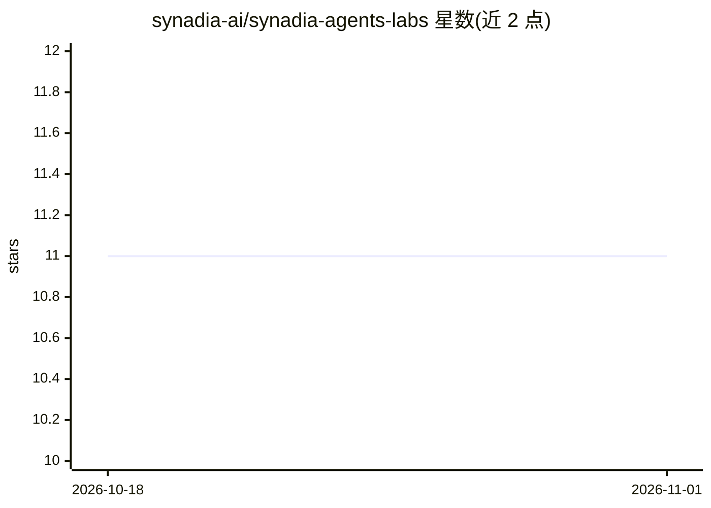

# synadia-ai/synadia-agents-labs

⭐ 11 · TypeScript · Apache-2.0 · 推送 2026-06-12 · [GitHub](https://github.com/synadia-ai/synadia-agents-labs) · [官网](https://github.com/synadia-ai/synadia-agents) · 组织维护

**NATS 原生 AI agent 的可运行示例与教学课程**

面向学习 Synadia Agent Protocol 的开发者，提供 TypeScript 与 Python 双语言的小型可运行示例：从五行的 echo agent 到调用工具、用 JetStream KV 持久记忆、跨 NATS 域访问传感器的 LLM agent，同时覆盖客户端侧（发现、流式提问、多轮对话、存活监测）。示例按文件夹自包含，可单独拷出运行；labs/ 提供 00→09 十份引导式实验讲义。LLM 后端可切换本地 Ollama 或 OpenRouter（同一代码、一个环境变量），也可连 NGS / Synadia Cloud。另带 Docker dev container 打包全套工具链。

## 筛选速览

| 维度 | 判定 | 备注 |
|---|---|---|
| AI 角色 | `ai-knowledge` | 知识聚合/清单类 |
| 许可风险 | `permissive` | Apache-2.0 |
| 部署形态 | `library` | 以包/库形式分发 |
| 模型依赖 | local-ok | 支持本地模型 |
| 硬件要求 | — | 无带数字的原话,不猜 |
| 安装摩擦 | `low` | 无编译、无系统依赖或容器化 |
| 成熟度 | — | 结构信号不足 |

## 能力要点

- 客户端与 agent 两侧的编号渐进式示例（TypeScript + Python）
- 项目级演示：工具调用、人在环、多 agent 组合、跨云/边缘传感器
- LLM 后端 Ollama / OpenRouter 一个环境变量切换，无需云端
- labs/ 十份讲义支持现场工作坊与自学两种路径

## 适用场景

- 按编号示例逐步学习 Synadia Agent Protocol 的 SDK 用法
- 以工具调用与持久记忆项目为起点搭建自己的 NATS agent
- 在工作坊或自学场景跟随 labs 讲义完成实操

## 场景标签

`教程课程` · 领域:学习与行业

## 证据(README 行号)

> L3: Hands-on, runnable examples for the **Synadia Agent Protocol for NATS** — learn
> L67: |🎓 **A guided course** — short lab sheets, for a live workshop or self-study|`labs/` — labs 00 → 09|

## 星数曲线

2026-10-18 11 → 2026-11-01 11（+0）

---
*卡片 v1 · prompt 1.4 · 生成 2026-11-01 · 置信度 mid · 依据 README sha `3bc1b1ad7037` · [字段定义](../../DATASET.md)*
