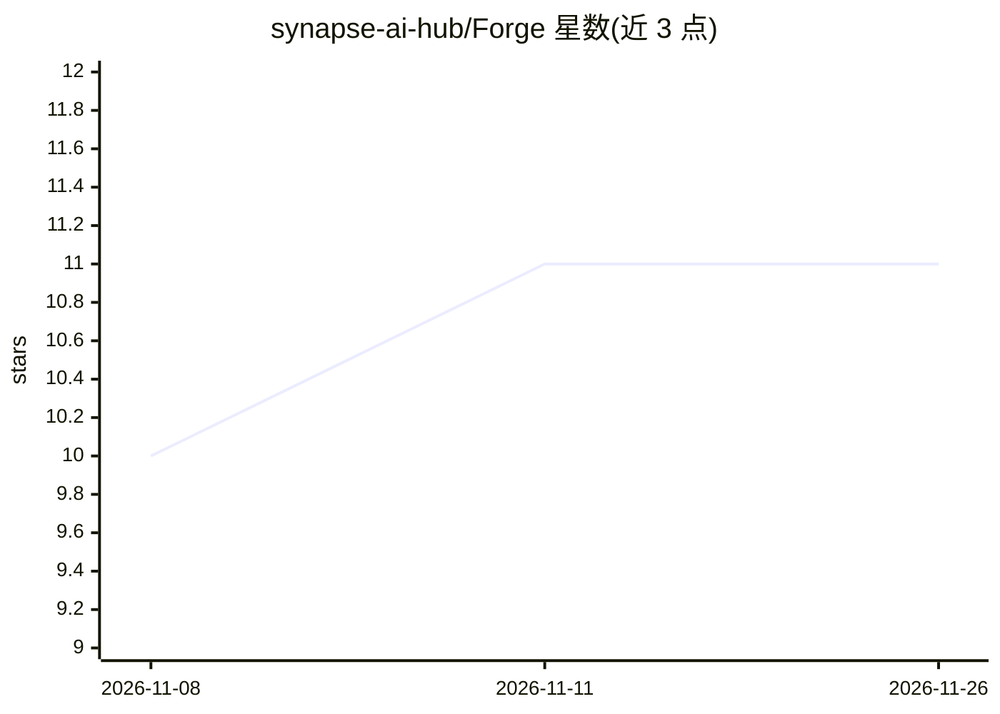

# synapse-ai-hub/Forge

⭐ 11 · Python · Apache-2.0 · 推送 2026-11-19 · [GitHub](https://github.com/synapse-ai-hub/Forge) · [官网](https://www.synapseaihub.com.ar) · 组织维护

**构建、编排并分发 AI agent 应用的开源 Python 框架**

以「定义—装备—运行—分发」流程组织的 Python 框架：用户用 .md 文件定义 agent 角色，配置技能、工具、RAG 集合与 YAML 工作流（DAG），由 Forge 转为带权限引擎、安全规则、agent 循环（SSE 流式）与持久记忆的系统。多提供商 LLM 支持（Ollama 本地 + 云端），MCP 协议接入外部工具服务器，可选决策模型做安全护栏。最终通过 pip 安装，产出 Docker 容器、桌面应用或便携 zip 分发包。面向需要构建自含 agent 应用的开发者。

## 筛选速览

| 维度 | 判定 | 备注 |
|---|---|---|
| AI 角色 | `ai-ecosystem` | LLM/agent 周边工具 |
| 许可风险 | `permissive` | Apache-2.0 |
| 部署形态 | `self-host` | docker 或自建部署 |
| 模型依赖 | local-ok | 支持本地模型 |
| 硬件要求 | — | 无带数字的原话,不猜 |
| 安装摩擦 | `low` | 无编译、无系统依赖或容器化 |
| 成熟度 | — | 结构信号不足 |

## 能力要点

- 以 .md 定义 agent、YAML 定义 DAG 工作流，含权限引擎与 deny-by-default 安全规则
- 多提供商 LLM：Ollama 本地可选 + 14 家 OpenAI 兼容云提供商与 Google
- MCP 集成（stdio/HTTP/SSE），17 个原生工具含子 agent 委托与邮件收发
- 分发产出：Docker 容器、内嵌 Python 的桌面应用或便携 zip

## 适用场景

- 从 pip install 到分发行自己的自含 agent 应用
- 需要权限控制与 prompt injection 防护的多 agent 系统
- 本地 Ollama 或多云端模型间切换的 agent 运行环境
- 用 DAG 工作流编排定时、可重试的后台 agent 任务

## 场景标签

`Agent 框架` `多智能体` `RAG` `工作流自动化` · 领域:Agent 开发

## 证据(README 行号)

> L15:  An open-source forge for creating, equipping, running and shipping autonomous AI agents.
> L59: - **Multi-provider LLM** — Ollama (local), curated cloud providers (OpenAI-compatible + Google)
> L103: FastAPI application with REST/SSE routers. The agent framework lives in `backend/agent/`: AgentLoop with native to

## 星数曲线

2026-11-08 10 → 2026-11-26 11（+1）

---
*卡片 v1 · prompt 1.4 · 生成 2026-11-18 · 置信度 high · 依据 README sha `165c2634e620` · [字段定义](../../DATASET.md)*
