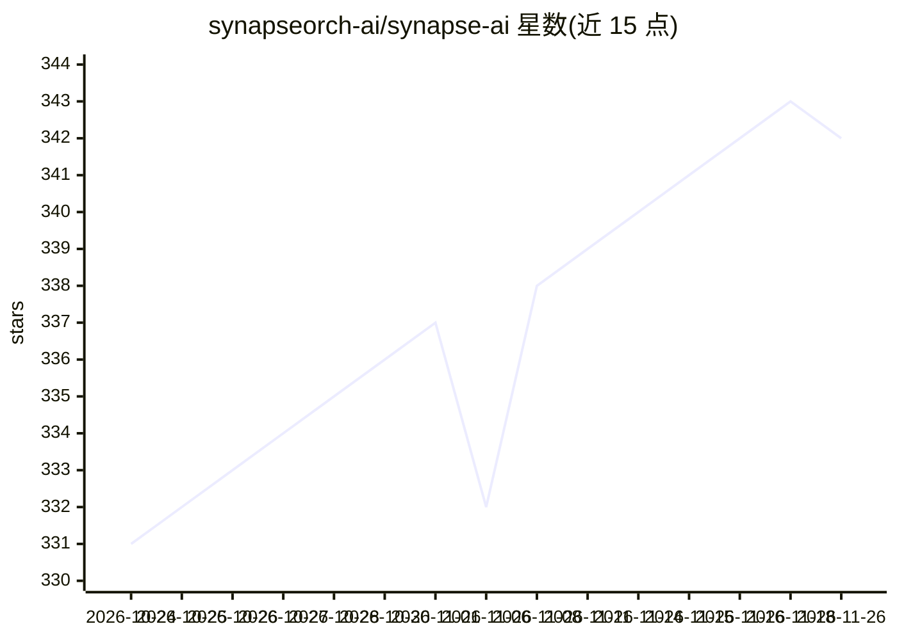

# synapseorch-ai/synapse-ai

⭐ 342 · Python · AGPL-3.0 · 推送 2026-11-25 · [GitHub](https://github.com/synapseorch-ai/synapse-ai) · [官网](https://synapseorch.com) · 组织维护

**面向企业的可审批 AI 工作流编排与运行平台**

企业 AI 工作流平台，开源引擎可自托管：用自然语言描述任务后，由 Synapse AI 助手生成工作流计划（步骤、每步所用模型、预估成本、人工签核点），经用户批准后按固定路径定时运行。支持多 agent 与团队协作、23+ 模型提供商接入、MCP 服务器/客户端、Slack 等聊天渠道审批、每步成本核算与支出上限。AGPL-3.0 许可，无账号、无遥测；Cloud 托管版为付费服务，另提供 1.x 到 2.0 的数据迁移与备份机制。

## 筛选速览

| 维度 | 判定 | 备注 |
|---|---|---|
| AI 角色 | `ai-ecosystem` | LLM/agent 周边工具 |
| 许可风险 | `viral` | AGPL-3.0 |
| 部署形态 | `self-host` | docker 或自建部署 |
| 模型依赖 | local-ok | 支持本地模型 |
| 硬件要求 | — | 无带数字的原话,不猜 |
| 安装摩擦 | `low` | 无编译、无系统依赖或容器化 |
| 成熟度 | — | 结构信号不足 |

## 能力要点

- 描述任务生成可读、可审批的工作流计划，运行严格按已批准路径执行
- 签核步骤支持应用内、Slack、Telegram 等渠道人工确认
- 每次运行展示每步成本，支持支出上限与超限停止
- 提供 CLI、REST API、MCP 服务器与 OpenAI 兼容端点多种使用入口

## 适用场景

- 销售跟进、营销内容、客户报告等业务流程的自动化
- 需要人工审批关键操作步骤的 AI 工作流
- 本地模型运行且数据不出机器的自动化任务
- 多模型多步骤、需要成本核算与预算控制的定时任务

## 场景标签

`多智能体` `工作流自动化` · 领域:Agent 开发

## 证据(README 行号)

> L9: **SynapseOrch is an AI solution for businesses.** It brings AI agents and automated
> L100: |**SynapseOrch**|An app that builds and runs AI workflows, with a UI, REST API, CLI and MCP server|Describing it (

## 星数曲线

2026-10-24 331 → 2026-11-26 342（+11）

---
*卡片 v1 · prompt 1.4 · 生成 2026-11-26 · 置信度 high · 依据 README sha `cd3388733f6d` · [字段定义](../../DATASET.md)*
