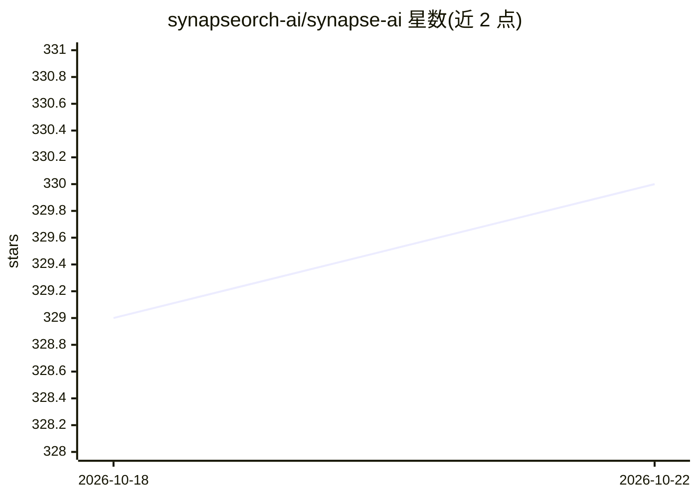

# synapseorch-ai/synapse-ai

⭐ 330 · Python · AGPL-3.0 · 推送 2026-10-02 · [GitHub](https://github.com/synapseorch-ai/synapse-ai) · [官网](https://synapseorch.com) · 组织维护

**开源多智能体编排平台：将 Agent、工具与任意 LLM 接成 DAG 工作流**

用于创建、连接与编排 AI Agent 的开源平台，支持本地、云端及 CLI 共 14+ 种 LLM 提供商（Ollama、OpenAI、Anthropic、Gemini、xAI、DeepSeek、AWS Bedrock 等）。Agent 通过 MCP server、webhook 或 Python 脚本接入真实工具（浏览网页、查数据库、执行代码等）；编排以确定性 DAG 执行，支持每步使用不同模型、人工审核门、Cron 调度与消息推送（Slack/Discord/Telegram 等）。提供 UI、CLI 与 V2 REST API；Scale Mode 经 Redis 队列、独立 worker 与 Postgres 检查点实现分布式扩展。许可为 AGPL v3。安装途径含脚本、npm、pip 与 Docker。

## 筛选速览

| 维度 | 判定 | 备注 |
|---|---|---|
| AI 角色 | `ai-ecosystem` | LLM/agent 周边工具 |
| 许可风险 | `viral` | AGPL-3.0 |
| 部署形态 | `self-host` | docker 或自建部署 |
| 模型依赖 | local-ok | 支持本地模型 |
| 硬件要求 | — | 无带数字的原话,不猜 |
| 安装摩擦 | `low` | 无编译、无系统依赖或容器化 |
| 成熟度 | — | 结构信号不足 |

## 能力要点

- 确定性 DAG 编排，每个步骤可指定不同 LLM
- 14+ LLM 提供商（本地/云端/CLI），可与 Ollama 全本地运行
- 任意 Python 脚本、REST API、webhook、MCP server 均可转为 Agent 工具
- Scale Mode：Redis 队列 + 独立 worker 集群 + 每步检查点恢复

## 适用场景

- 搭建多 Agent 协作的研究、写作或代码生成流水线
- 用自然语言让 AI Builder 生成编排 DAG
- 全本地（Ollama）运行多 Agent 工作流并保持数据不出本机
- 经 Slack/Telegram 等渠道接入人工审核与定时任务

## 场景标签

 · 领域:AI Agent 编排/工作流平台

## 证据(README 行号)

> L16: **Wire agents, tools, and LLMs into deterministic pipelines — without the framework lock-in.** Synapse is an open-s
> L98: - **Deterministic DAG Execution** — Orchestrations follow the exact path you designed. No hallucinated detours.

## 星数曲线

2026-10-18 329 → 2026-10-22 330（+1）

---
*卡片 v1 · prompt 1.4 · 生成 2026-10-21 · 置信度 high · 依据 README sha `aa31846fe211` · [字段定义](../../DATASET.md)*
