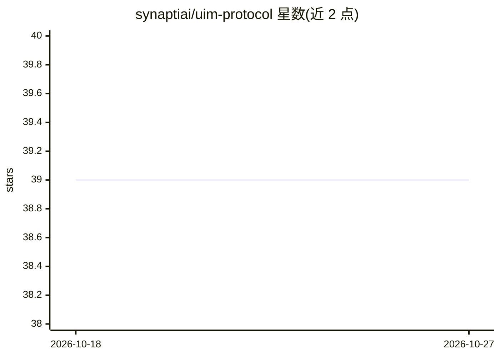

# synaptiai/uim-protocol

⭐ 39 · HTML · Apache-2.0 · 推送 2026-10-23 · [GitHub](https://github.com/synaptiai/uim-protocol) · [官网](https://synaptiai.github.io/uim-protocol/) · 组织维护

**AI agent 与 Web 服务交互的标准化协议规范**

Unified Intent Mediator (UIM) 协议定义 AI agent 通过结构化 intent 与 Web 服务交互的规范：Web 服务暴露带元数据与参数的 intent，agent 经发现 API 查找、执行 API 调用；包含数字签名权限的 Policy Adherence Tokens、基于 DNS TXT 记录与 agents.json 文件的端点发现机制。支持集中式、去中心式与混合三种架构，仓库含参考实现与 MkDocs 文档。目前处于草案提案阶段，面向开发者、AI 提供方与服务运营方征集反馈。

## 筛选速览

| 维度 | 判定 | 备注 |
|---|---|---|
| AI 角色 | `ai-ecosystem` | LLM/agent 周边工具 |
| 许可风险 | `permissive` | Apache-2.0 |
| 部署形态 | `None` |  |
| 模型依赖 | — | README 未给出锁定关系 |
| 硬件要求 | — | 无带数字的原话,不猜 |
| 安装摩擦 | `low` | 无编译、无系统依赖或容器化 |
| 成熟度 | `idea` | |

## 能力要点

- intent + 元数据/参数 + 发现与执行 API 的交互模型
- Policy Adherence Tokens 封装权限、计费与合规规则
- DNS TXT 记录与 agents.json 端点发现机制
- 集中式/去中心式/混合三种架构选项，附参考实现

## 适用场景

- 为 Web 服务设计可供 AI agent 调用的标准化接口
- 构建需要跨服务发现并执行 intent 的 agent 应用
- 评估 agent-Web 服务交互协议的草案设计并提出反馈

## 场景标签

`Agent 框架` · 领域:Agent 开发

## 证据(README 行号)

> L84: The Unified Intent Mediator (UIM) protocol defines a standardized framework for AI agents to interact with web serv
> L91: - **Discovery and Execution APIs**: AI agents can query discovery APIs to find available intents and use execution 

## 星数曲线

2026-10-18 39 → 2026-10-27 39（+0）

---
*卡片 v1 · prompt 1.4 · 生成 2026-10-25 · 置信度 high · 依据 README sha `5c095c73aa5a` · [字段定义](../../DATASET.md)*
