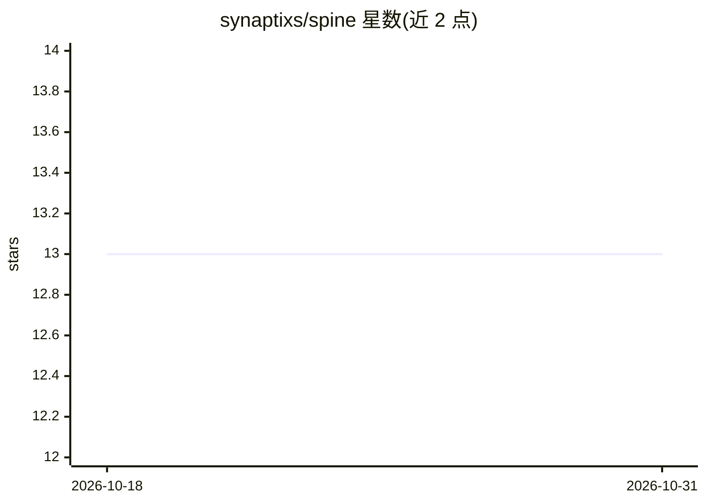

# synaptixs/spine

⭐ 13 · Python · MIT · 推送 2026-10-30 · [GitHub](https://github.com/synaptixs/spine) · [官网](https://test.pypi.org/project/agent-orchestrator/) · 组织维护

**自主软件交付编排器：需求经人审门控生成已测试的 PR**

以 uv 安装的命令行编排器（命令 orchestrator，包 synaptixs-spine）：从 Confluence/Notion/Markdown/OpenSpec 读入需求，用解析器构建目标仓库的确定性知识图谱（file:line 溯源），生成构建计划供人审批后按阶段调用 LLM 生成代码，本地分支验证，选择 --live 才开 PR，合并前后各有人审门控。覆盖 14 种前端语言理解与 10 种语言代码生成，支持本地/离线或混合 provider 按阶段选模型，可消费与暴露 MCP 工具。README 附带测量数据与局限说明；自主多特性流水线需 Temporal+Postgres。

## 筛选速览

| 维度 | 判定 | 备注 |
|---|---|---|
| AI 角色 | `ai-ecosystem` | LLM/agent 周边工具 |
| 许可风险 | `permissive` | MIT |
| 部署形态 | `None` |  |
| 模型依赖 | local-ok | 支持本地模型 |
| 硬件要求 | — | 无带数字的原话,不猜 |
| 安装摩擦 | `medium` | 含编译或系统依赖之一 |
| 成熟度 | — | 结构信号不足 |

## 能力要点

- 解析器构建带 file:line 溯源的确定性仓库知识图谱
- 两道人审门控：构建前审批构建文档、合并前人工评审 PR
- 支持本地/离线（Ollama）或混合 provider，按阶段选择模型
- 消费与暴露 MCP 工具，可被 Claude Code、Codex 等 MCP 宿主调用

## 适用场景

- 把需求工单转化为经人工评审与测试的拉取请求
- 在花费模型 token 前审查仓库图谱与构建计划
- 在本地离线模型上跑通代码生成流程

## 场景标签

`编码 Agent` · 领域:编码与开发

## 证据(README 行号)

> L5: **Turn requirements into reviewed, tested pull requests, with a human in control.**
> L127: |Local/offline or mixed-provider models, selected per stage|✅|`models`; configuration|
> L130: |Consume external MCP tools, database schema and Confluence/Jira docs|✅|`mcp list`, `mcp call`, `mcp contracts`, `

## 星数曲线

2026-10-18 13 → 2026-10-31 13（+0）

---
*卡片 v1 · prompt 1.4 · 生成 2026-10-31 · 置信度 high · 依据 README sha `4ba0b77eb611` · [字段定义](../../DATASET.md)*
