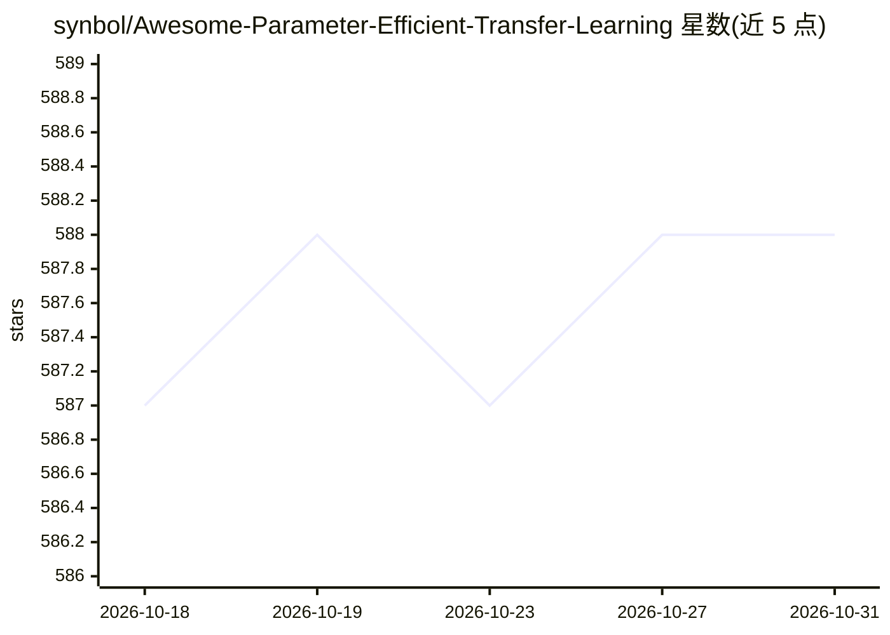

# synbol/Awesome-Parameter-Efficient-Transfer-Learning

⭐ 588 · 推送 2025-12-10 · [GitHub](https://github.com/synbol/Awesome-Parameter-Efficient-Transfer-Learning) · 个人维护

**参数高效迁移学习（PEFT）论文与数据集资源清单**

面向研究者整理的 parameter-efficient fine-tuning 资源合集：按 Addition-based（Adapter/Prompt/Prefix/Side Tuning）、Partial-based、Unified-based 三类分类体系组织论文条目，每个条目给出会议/期刊出处、作者与 Paper/Code 链接；此外收录常用数据集与应用介绍。当前可见部分覆盖 Adapter Tuning 与 Prompt Tuning 两个子类共 50 余条论文，涉及视觉、视频、点云、扩散模型与多模态任务。本体为清单，不含可安装运行的代码。

## 筛选速览

| 维度 | 判定 | 备注 |
|---|---|---|
| AI 角色 | `ai-knowledge` | 知识聚合/清单类 |
| 许可风险 | `none` | — |
| 部署形态 | `None` |  |
| 模型依赖 | — | README 未给出锁定关系 |
| 硬件要求 | — | 无带数字的原话,不猜 |
| 安装摩擦 | `low` | 无编译、无系统依赖或容器化 |
| 成熟度 | — | 结构信号不足 |

## 能力要点

- 按 Addition-based / Partial-based / Unified-based 三类体系组织论文
- 每条含出处、作者与 Paper/Code 链接
- 收录 Adapter Tuning、Prompt Tuning 等子类数十条论文
- 另含常用数据集与贡献指引章节

## 适用场景

- 查找特定方向的 PEFT 论文与开源代码
- 了解参数高效微调方法的分类体系
- 为综述写作或方法选型收集文献线索

## 场景标签

`精选清单` · 领域:学习与行业

## 证据(README 行号)

> L11: 𝓐 𝓬𝓸𝓵𝓵𝓮𝓬𝓽𝓲𝓸𝓷 𝓸𝓯 𝓻𝓮𝓼𝓸𝓾𝓻𝓬𝓮𝓼 𝓸𝓷 𝓹𝓪𝓻𝓪𝓶𝓮𝓽𝓮𝓻-𝓮𝓯𝓯𝓲𝓬𝓲𝓮𝓷𝓽 𝓽𝓻𝓪𝓷𝓼𝓯𝓮𝓻 𝓵𝓮𝓪𝓻𝓷𝓲𝓷𝓰.
> L42: * This repository provides a comprehensive overview and offer a systematic review of the latest advancements. It in

## 星数曲线

2026-10-18 587 → 2026-10-31 588（+1）

---
*卡片 v1 · prompt 1.4 · 生成 2026-10-21 · 置信度 high · 依据 README sha `cb85c9084fb9` · [字段定义](../../DATASET.md)*
